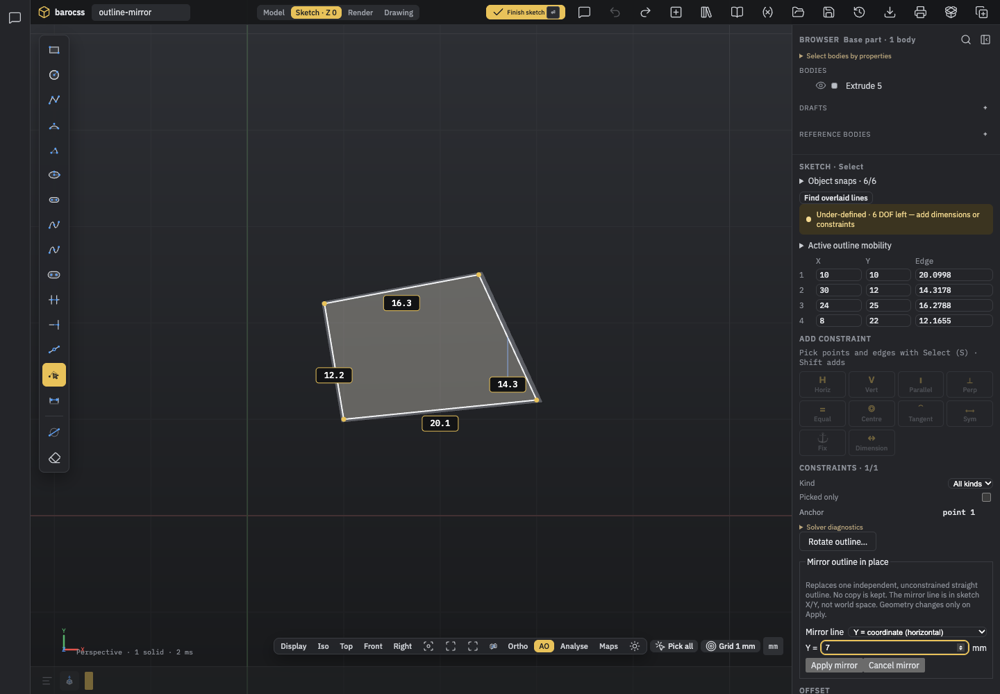
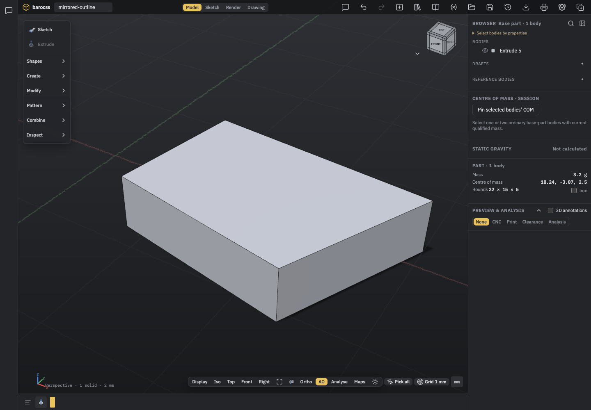
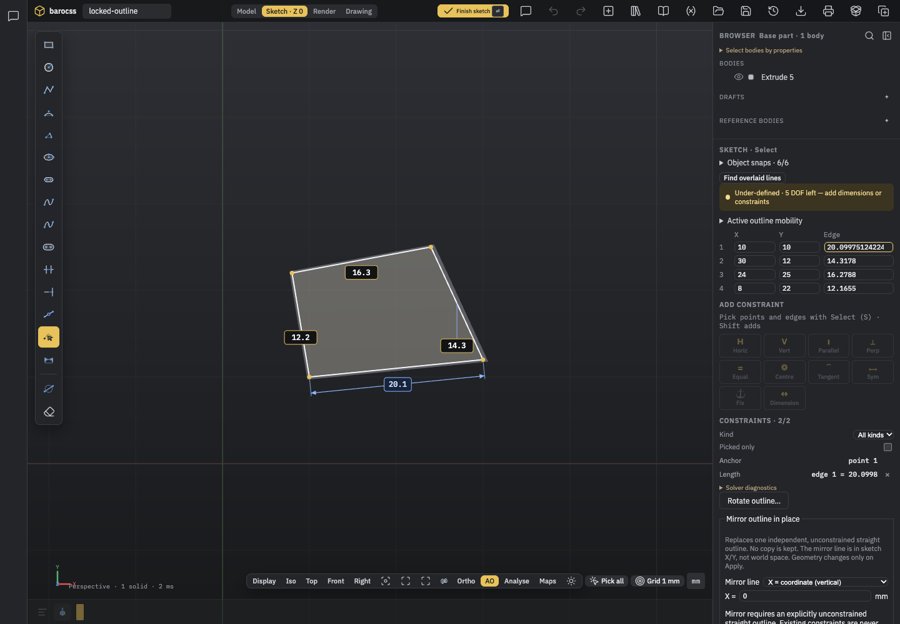

# Mirror outline in place · #633 · 2026-11-17

## User contract

Reflect one independent explicitly unconstrained settled straight closed polygon (3–16 points) about sketch-local X = coordinate or Y = coordinate. **In place means replacing the outline, not keeping a copy.** This is not a body/world transform or a derived pattern. UI names and explanatory text make that distinction explicit. Input only changes a draft; Apply commits, Cancel/Escape discard. Enter in an input does not Finish.

Curved/derived/associated/band, constrained and multiple material outlines are refused. Construction siblings remain untouched. Existing numeric bounds and polygon admission are reused through the zero-rotation validator; its refusal wording is adapted to Mirror. No solver, kernel, schema or permanent feature is introduced. Existing HOLD scopes remain intact.

Point order and side IDs are deliberately not reversed: side i joins reflected points i and i+1. Winding reverses naturally. Existing profile/native consumers own winding normalization. Manually reversing IDs here would assign them to the wrong physical sides.

The existing coordinate-edit action-time guard checks document, rendered owner, live shape and generation. Both Rotate and Mirror panels use the same guarded callback. Applying one invalidates the other's draft; changing documents clears draft ownership.

## Verification

- Studio TypeScript PASS.
- Focused `mirror-outline rotate-outline outline-rotation-commit sketch-edit-identity constraints`: **71/71 PASS**.
- Changed-file ESLint and diff whitespace check PASS. An initial copied-driver unused-variable lint failure was fixed before final lint; no product behavior failure was observed.
- Vite production build PASS, 6.95 s.
- Actual Chrome flow: first run PASS. Source-frozen lifecycle receipt, no runtime/console errors, clean browser/server shutdown.
- Independent core/winding and UI/ownership reviews: no remaining blocker. The UI reviewer requested a native side-to-wall assertion; it was included before the actual run.
- Mutation **4/4 killed**, baseline 9/9 before/after, product hash unchanged. Mutations: wrong factor, swapped axis, reversed IDs, combined pre/post admission bypass. See sanitized receipt.

This is focused FEATURE validation with independent reviews and mutation tests, not a full repository/kernel suite. Model/kernel sources were unchanged. General constrained/circular/associated mirror, copies and arbitrary-angle mirror lines are outside this leaf.

## Actual workflow and geometric oracle

Synthetic asymmetric outline `[[10,10],[30,12],[24,25],[8,22]]`, height 5. Actual UI verifies blank input and Enter refusal, Escape/Cancel, X=0 reflection, sketch Undo/Redo, pending Rotate draft retirement on Mirror Apply, Y=7 reflection, Finish, document Undo/Redo, physical native Save/fresh Open and re-edit. Replacing a pending Mirror draft with a constrained document resets its coordinate to 0, refuses Apply and preserves the complete accepted document.

Independent exact formulas `[-x,y]` and `[x,14-y]` establish expected coordinates. Native output is valid, volume agrees with independent shoelace area × height within 1e-8, and all eight expected extrusion vertices are present. Each `n1.side[tag]` face's coedge vertices belong to the two reflected endpoints of the original indexed side. This verifies physical side ownership after winding reversal, not merely equal tag arrays. Unit tests separately cover concavity, double reflection, signed area reversal, lengths, immutability and invalid atomic rejection.

Reproduce after building Studio using Node 22:

```sh
cd apps/cad-studio
OUTLINE_MIRROR_SOURCE_FROZEN=1 PW_DIR="$HOME/.cache/barocss-playwright" CHROME='/Applications/Google Chrome.app/Contents/MacOS/Google Chrome' node test/sketch-outline-mirror-browser.mjs /tmp/mirror-evidence
```

Pixels reviewed at 1440×1000. The Mirror line form is legible; the longer constraint refusal continues below the visible scrollable panel. The automated flow separately verifies its alert and disabled Apply. No claim that this screenshot shows the whole alert. Fresh-open shows the reflected solid.




