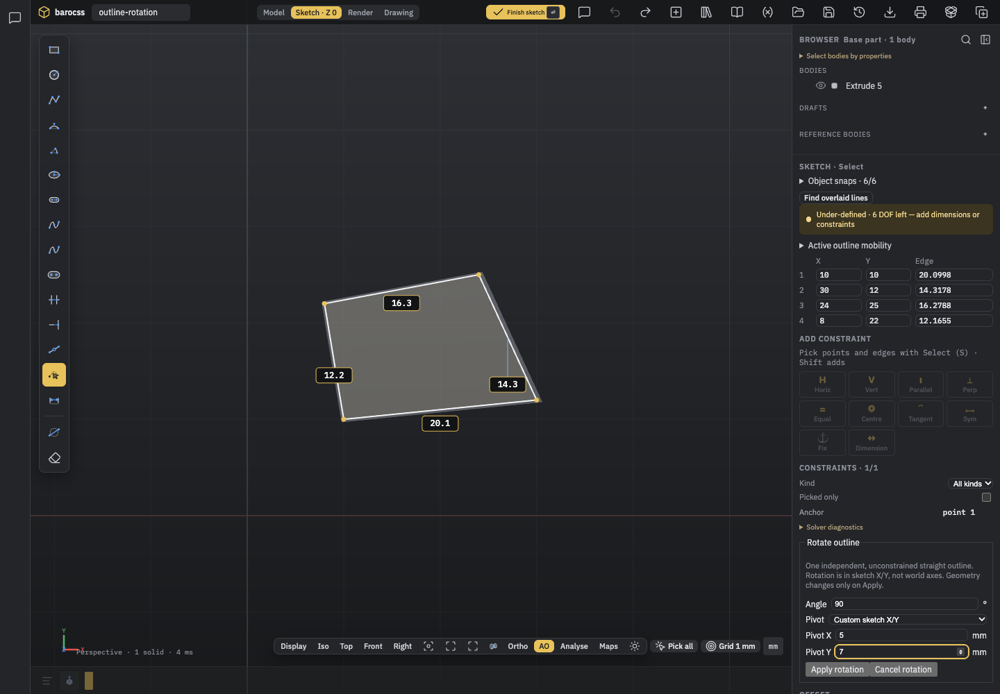
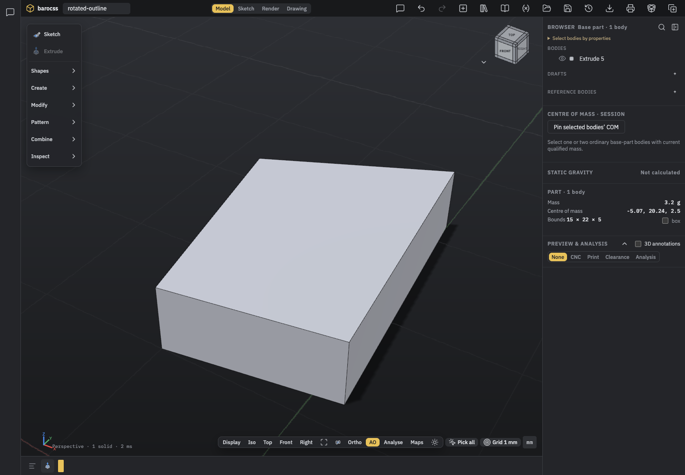
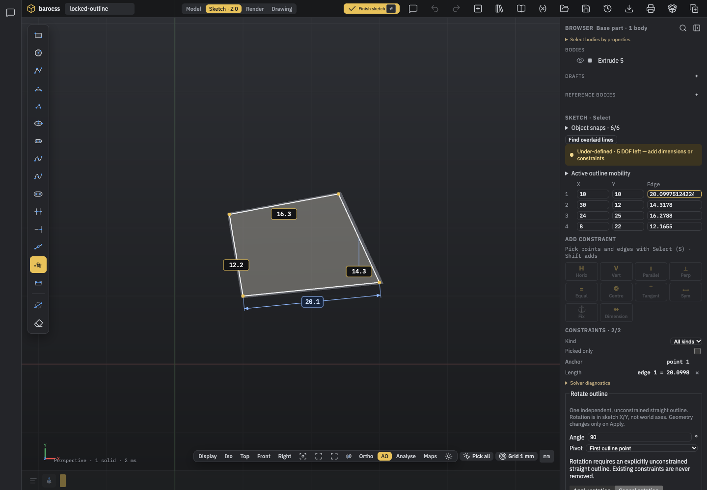

# Sketch outline numeric rotation · #632 · 2026-11-17

## Delivered scope

The Sketch panel rotates one independent, settled, explicitly unconstrained closed straight polygon (3–16 points) in sketch-local X/Y. Signed degrees use the first point or an explicit local pivot. Input alone does not change geometry: Apply is explicit; Cancel and Escape discard it. Enter in inputs does not Finish the sketch. Whole turns are no-ops.

Existing constraints are never removed. Associated/band, curved/derived, pending, multiple material outlines, invalid or out-of-range geometry are refused. Construction siblings and vertex/side identities remain unchanged. This is a coordinate edit through the existing settle, draft undo and document commit paths, not a new permanent feature or schema. Constrained rotation, world-space rotation and solver/kernel widening remain outside this leaf.

Drafts belong to the exact sketch and document. A synchronous Apply guard checks current document, rendered sketch, live shape and generation before dispatch. Independent review found that checking only rendered props could admit a stale callback; this was fixed before publication and covered by zero-effect stale-owner/generation tests. This finding was static, not a reproduced browser race.

## Verification

- Studio TypeScript: PASS.
- Focused Studio suite (`node scripts/test.mjs rotate-outline outline-rotation-commit sketch-edit-identity constraints`): **66/66 PASS**.
- Scoped ESLint and `git diff --check`: PASS.
- Studio Vite production build: PASS (6.46 s).
- Actual Chrome production flow: PASS, source-frozen final run. Initial pre-guard browser run also passed; final run reran after guard addition.
- Two independent reviews; final re-review no blocker.
- Helper mutation checks: **4/4 killed** (wrong sign, dropped constraint guard, wrong pivot, non-no-op whole turn); baseline 4/4 before and after, product source unchanged. See `mutation-summary.json`.

FULL review here means independent reviews plus mutation evidence, not a whole-repository suite. Model/kernel sources were untouched; full kernel and Model suites were not rerun. Latest drawing-only main `c5c1d3b8b` was fast-forward integrated without overlapping source changes.

## Actual workflow and independent oracle

`test/sketch-outline-rotation-browser.mjs` uses a synthetic asymmetric four-point profile and a 5 mm extrusion. It checks blank/Enter/Escape/Cancel, 90° first-point pivot, custom (5,7) pivot, draft Undo/Redo, Finish, preserved node/side tags, document Undo/Redo, actual native Save and fresh Open, exact document equality, re-edit, and replacing a pending draft with a constrained document. The constrained outline is refused with its original geometry and constraint intact.

Expected points use independently written quarter-turn equations. Native B-rep validity, all eight expected extrusion vertices and shoelace-area × height volume are checked independently (1e-8 tolerance), not solely by screenshot or helper agreement. Arbitrary 45° rotation, negative/cardinal angles and rejection boundaries have focused unit coverage.

Run after building Studio with Node 22, installed Playwright and Chrome:

```sh
cd apps/cad-studio
OUTLINE_ROTATION_SOURCE_FROZEN=1 PW_DIR="$HOME/.cache/barocss-playwright" CHROME='/Applications/Google Chrome.app/Contents/MacOS/Google Chrome' node test/sketch-outline-rotation-browser.mjs /tmp/outline-rotation-evidence
```

Sanitized `receipt-summary.json` contains run qualification, cleanup and native-file checks without host paths. Screenshots were visually inspected: the form is readable in the scrollable panel; fresh-open shows the rotated solid; constrained refusal explicitly explains why Apply is disabled.




