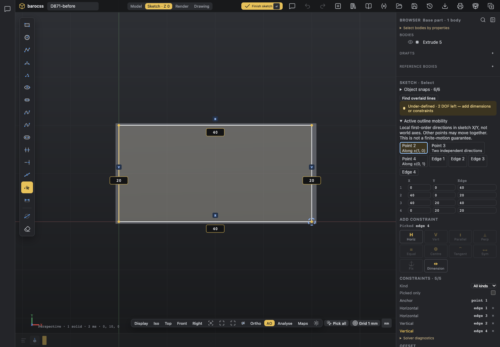
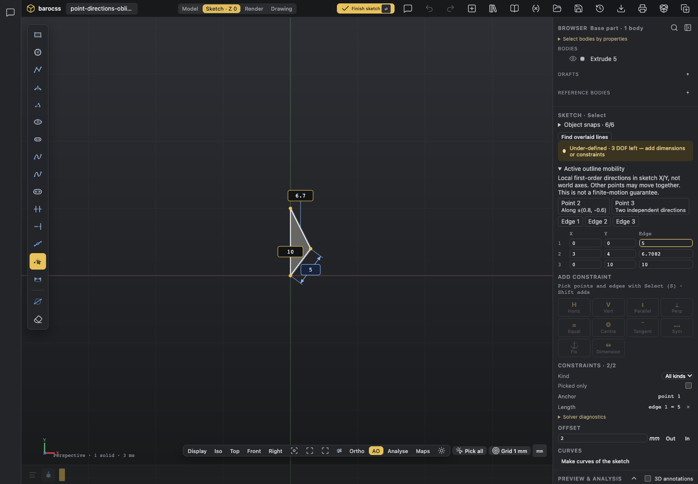

# Sketch point mobility directions · 2026-11-17

Issue #21, FULL diagnostic API extension. Implementation baseline `134a7c102ba7559d641ffd022e77dbdc8f243cb7`; integrated unrelated drawing main `d2dd7cdb1` by fast-forward. No schema, solver, B-rep, geometry, tolerance or stored constraint change. Existing WIP and HOLD scopes preserved.

## Useful behavior

The existing Active outline mobility panel now explains each movable point's **local first-order span**: a unit tangent `Along ±(x, y)`, `Two independent directions`, or `Direction unavailable`. Axes are sketch-local, not world axes. Other points may need to move simultaneously. These are not finite paths, independent movement permissions, a rigidity certificate, or inferred conflict causes. Point and edge hover/focus highlighting is unchanged. Direction is also an accessible description.

Admission remains the existing settled, closed, non-construction straight outline of at most 16 points and its supported constraints. Curved/compound/associated cases are not widened. The anchored first point and unsupported result behavior remain unchanged.

Kernel `diagnoseXYNumericalSketchMobility` adds `pointDirections` without changing rank, residual or movable-point admission. A movable ID missing from that array means its direction is numerically unresolved, not fixed. The 2×k projected orthonormal nullspace uses the large singular value from its 2×2 Gram matrix and the small value from Cauchy–Binet minors divided by the large value, avoiding trace subtraction cancellation. The inherited uncertainty plus accumulation bound separates numerical zero from a resolvable second direction. Ambiguous results omit only the direction. One-dimensional vectors use a dominant-component sign convention; ± denotes an unoriented line, and exact tuple sign invariance at a diagonal tie is not promised. Display rounds to six decimal places only; no displayed number feeds an edit or constraint.

## Verification

- Kernel, Model, Studio TypeScript checks PASS; final Model check follows the last test edit. Scoped TypeScript/test lint and `git diff --check` PASS.
- Emitted kernel mobility + equal-length regressions: **12/12 PASS**. Independent rectangle X/Y spans, constrained oblique (3,4) radial vector with perpendicular tangent ±(.8,-.6), reordered points/constraints, basis rotation, uncertainty boundaries and existing solver rank/refusal behavior.
- Model focused: **51/51 PASS** (`outline-mobility sketch-profile-precision sketch-rectangle-driving-retention sketch-outline-field-identity sketch-conflict-proof fixed-triangle`). Authored points only, helper-point exclusion, unchanged geometry/IDs and fully locked empty directions.
- Studio focused: **65/65 PASS** (`point-motion-label constraints sketch-edit-identity fixed-triangle-inline-ownership viewport-sketch-overlay-band`), run from `apps/cad-studio`. An initial workspace-root run passed56/failed9 because existing tests resolve `test/fixtures/d348.bcad` relative to cwd; no product fix or fixture substitution.
- Production Vite build PASS, 13.54s. Existing dynamic-import/directive warnings remain.
- Two independent static audits found no blocker. **5/5 mutation probes killed**, unmodified kernel7/7 and UI2/2 baseline passes before/after. See [mutation summary](mutation-summary.json); source hashes unchanged by the in-memory probes.

### Actual Studio

`sketch-point-directions-browser.mjs`, `POINT_DIRECTIONS_SOURCE_FROZEN=1`, Chrome 1440×1000. Final attempt05 PASS, all1055 frozen source files unchanged, page/console errors0, owned contexts/browser/server closed. Reuses the actual D871 lifecycle, not injected application state.

- 40×20 anchored H/V rectangle: point2 tangentX, point3 two directions, point4 tangentY. Width lock leaves points3/4 tangentY; height lock removes mobility. Remove/edit, refusal, draft Undo/Redo, inline edit focus, point/edge inspection, Escape and unchanged selection/history/document verified.
- Finish and document Undo/Redo preserve the sketch IDs and downstream Extrude; native output validity, eight expected vertices and analytic volume4000mm³ remain within original1e-8 tolerance. Browser-project Save and fresh-context Open preserve exact native JSON, no mobility storage metadata.
- Same-ID translated replacement: Keep editing retains directions; explicit Discard clears previous owner/highlight. Unsupported circle has no disclosure.
- Independent triangle [(0,0),(3,4),(0,10)] with first-edge length5 displays ±(.8,-.6) at point2 and two directions at point3. Focus/Escape changes no document/history/worker/write counters. Finish is exact no-op; browser-project Save/fresh Open retains the tangent. This is a first-order oracle, not proof the tangent itself is a finite straight trajectory.

Actual pixels reviewed, synthetic fixtures only:

### Initial attempts, not concealed passes

1. Initial navigation exceeded inherited10s startup budget before the workflow. Navigation-only budget raised to60s.
2. The reused driver expected visible rank text inside the now-collapsed Solver diagnostics. Visible direction UI was already correct; rank inspection now waits for attached DOM while actual mobility rows remain visibly asserted.
3. The old replacement step omitted the current Discard sketch changes confirmation. Rectangle edit/history/native fresh Open had passed; driver now exercises Keep editing and explicit Discard.
4. New oblique assertion ran immediately after disclosure toggle, before React rendered rows. Failure screenshot already displayed the correct tangent; assertion now awaits visible direction rows. Product code was not changed for these retries.

See [receipt summary](receipt-summary.json). These failures are harness/setup outcomes, not a claim that unvisited later steps passed. Final run covers all listed flows.

## Reproduction and limits

From repository root with Node22: `node packages/barocss-cad/scripts/tool.mjs build:fast`, then `node --test packages/barocss-cad/test/xy-numerical-sketch*.test.mjs`; use each package's test runner for the focused names above. Browser runs from `apps/cad-studio`, using the existing `flow-helper.mjs`, Playwright installation and Chrome executable environment variables.

Whole suites NOT_RUN; FULL is independent audits plus mutation, not automatic full-kernel execution. B-rep core unchanged. No viewport direction arrow/new handles, finite-motion solver, multi-outline/curve mobility, mobile/physical-DPI qualification or universal numerical certification. Initial old UI/issue breadth remains open. #21 is not closed by this slice. No doc-sync campaign, release or deployment.
