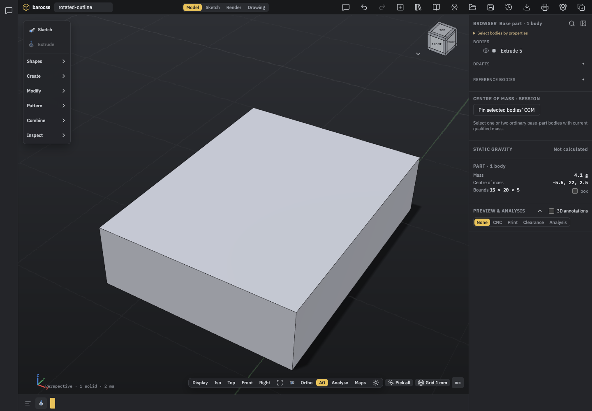
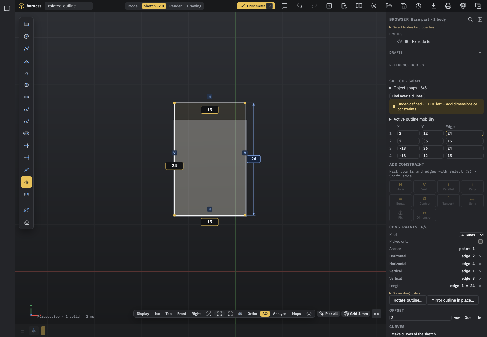

# Constraint-preserving sketch quarter turns · #635 · 2026-11-17

## Scope

One independent straight outline with only H/V and numeric edge lengths now supports exact multiples of 90 degrees about the first point or explicit sketch-local pivot. Odd quarter turns swap H/V index lists; half turns retain them. Lengths and physical side IDs remain attached to their original indexed edges. Whole turns return the original shape. No silent constraint removal, arbitrary constrained rotation or permanent Rotate feature.

The Mirror metadata and exact-settle checks were extracted into `orthogonalOutlineConstraints.ts`. Rotation and Mirror share them without a cycle. Other rules/fix/angle, curves/derived, linked/band and multiple material outlines remain refused. Exact source H/V, canonical valid indices/lengths and source residual checks remain; any solver repair/rounding of transformed coordinates is refused. Existing HOLD, kernel/solver/schema and document serialization are unchanged. Existing unconstrained arbitrary-angle behavior is retained.

## Review finding and initial failure

Independent review found that normalizing a negative remainder with +360 before the quarter-turn check could round `-90.00000000000001` to 270, accepting an angle that was not exactly a multiple of 90. The guard now checks the raw remainder first. Both that input and `-1e-14` have rejection tests; a normalized-guard mutation is killed. This was a static/math finding fixed before browser validation, not a reported user-model failure.

The first TypeScript integration failed on the intentionally invalid `'00'` length-key fixture. An explicit malformed-record cast fixed the test type. The complete verification sequence was rerun afterward; product logic did not change for this type fix.

## Final evidence

- Studio tsc, scoped ESLint and diff check PASS.
- Focused `mirror-outline rotate-outline outline-rotation-commit sketch-edit-identity constraints`: **81/81 PASS**.
- Vite production build PASS (7.12 s).
- Actual Chrome: unconstrained rotation regression, constrained quarter-turn lifecycle and constrained Mirror regression all PASS on their first browser executions. Source capsules unchanged, no runtime/console errors, clean shutdown.
- Two independent reviews, final re-review approved after the negative-angle correction.
- **5/5 mutations killed**: normalized-angle guard, missing H/V swap, missing lengths, missing quarter-angle guard, missing exact-settle guard. Before/after focused mutation baselines 19/19; source hash unchanged. The broader 81-test suite is separate.

## Actual workflow/oracles

The main rectangle has H/V and driving edge 1=20. Actual input covers blank/Enter/Escape/Cancel, 45-degree rejection, 90-degree first/custom-pivot Apply and sketch/document Undo/Redo. Finish retains the same physical side IDs, swaps H/V to h=[1,3], v=[0,2], and keeps length 20. Independent quarter-turn coordinate equations, native validity, all eight extrusion vertices, shoelace area×5 volume and named-wall endpoints pass.

A physical native Save and fresh-context Open preserves the full document. Re-editing the now-vertical edge 1 from 20 to 24 changes exactly the expected coordinates and yields native volume 15×24×5, with Undo/Redo. Existing **Normal and fit sketch** is used to show this draft; no new camera behavior is introduced. Explicit fixed-point geometry still refuses after document replacement without losing constraints.

This is focused validation, not full repository/kernel certification. Final dimension re-edit was not saved a second time, nor was physical side identity requalified after that resizing. General constrained/curved/linked rotations and exact rounding-sensitive constrained coordinates remain outside scope.

## Reproduce

After building Studio, Node 22 and the installed Playwright/Chrome:

```sh
cd apps/cad-studio
OUTLINE_ROTATION_SOURCE_FROZEN=1 PW_DIR="$HOME/.cache/barocss-playwright" CHROME='/Applications/Google Chrome.app/Contents/MacOS/Google Chrome' node test/sketch-outline-rotation-browser.mjs /tmp/rotation-free
QUARTER_TURN_SOURCE_FROZEN=1 PW_DIR="$HOME/.cache/barocss-playwright" CHROME='/Applications/Google Chrome.app/Contents/MacOS/Google Chrome' node test/sketch-quarter-turn-browser.mjs /tmp/quarter-turn
MIRROR_CONSTRAINTS_SOURCE_FROZEN=1 PW_DIR="$HOME/.cache/barocss-playwright" CHROME='/Applications/Google Chrome.app/Contents/MacOS/Google Chrome' node test/sketch-mirror-constraints-browser.mjs /tmp/mirror-regression
```

Pixels reviewed at 1440×1000: the rotated solid reopens; the editable sketch shows swapped H/V and the same edge 1 driving length now vertically oriented.



