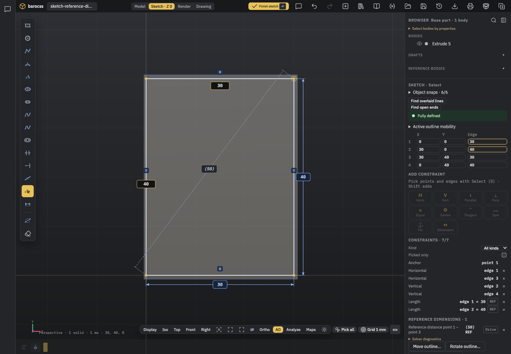
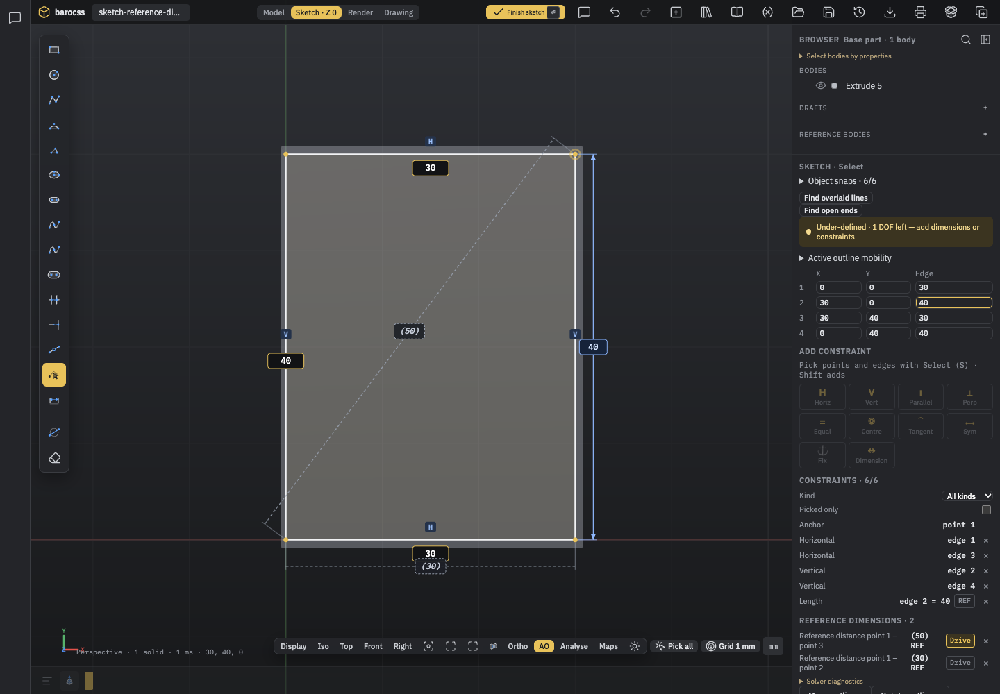
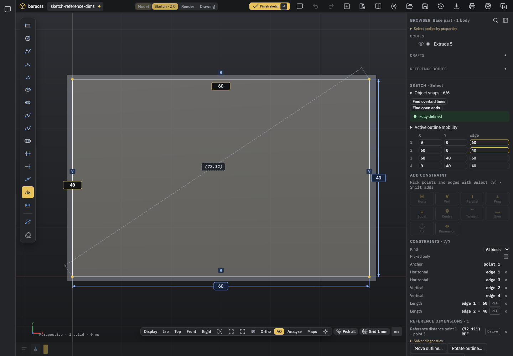

# D2016 — Persistent Sketch Reference Dimensions (`#230`)

Date: 2026-11-25 · Track: P1 Sketch & Constraints · Issue: [#230](https://github.com/barocss/cad/issues/230)

## Decision

Add persistent, non-driving read-only sketch reference dimensions (`SketchReferenceDimension`, `kind: 'distance' | 'dx' | 'dy'`) on closed numeric outlines (`SketchOutline.references`), bound strictly by stable endpoint side IDs (`aId`, `bId` matching `polygon.ids` / `sideTags.outer`), re-measured live from current accepted geometry without emitting any solver equations, and supporting explicit Driving ↔ Reference conversion.

## Implementation summary

- **Model (`packages/barocss-cad-model`):**
  - Added [`src/sketch/referenceDimensions.ts`](../../../../packages/barocss-cad-model/src/sketch/referenceDimensions.ts) (`ReferenceDimensionKind`, `SketchReferenceDimension`, `ResolvedReferenceDimension`, `ReferenceEditResult`, `resolveReferenceDimension`, `addReferenceDimension`, `removeReferenceDimension`, `isConvertibleToReference`, `convertDrivingToReference`, `convertReferenceToDriving`).
  - Bound endpoints strictly by stable `aId`/`bId` (`/^e\d+$/`, never bare array indices): vertex insertions carry references seamlessly to the same semantic corners, while deleted/ambiguous endpoints report `unresolved` instead of silently retargeting or showing stale values.
  - Wired optional `references?: SketchReferenceDimension[]` through [`src/sketch/types.ts`](../../../../packages/barocss-cad-model/src/sketch/types.ts), [`src/engine/doc.ts`](../../../../packages/barocss-cad-model/src/engine/doc.ts), [`src/sketch/loops.ts`](../../../../packages/barocss-cad-model/src/sketch/loops.ts) (preserving compact `profile: 'rectangle'`!), [`src/sketch/reopen.ts`](../../../../packages/barocss-cad-model/src/sketch/reopen.ts), [`src/sketch/entityIds.ts`](../../../../packages/barocss-cad-model/src/sketch/entityIds.ts), [`src/sketch/corner.ts`](../../../../packages/barocss-cad-model/src/sketch/corner.ts), and [`src/sketch/rules.ts`](../../../../packages/barocss-cad-model/src/sketch/rules.ts).
  - Kept `driven.ts` strict (parameter-bound `driven-sketch` remains outside first scope).
- **Studio (`apps/cad-studio`):**
  - Extended [`src/ui/ConstraintTools.tsx`](../../src/ui/ConstraintTools.tsx) with read-only **Ref dist / Ref horiz / Ref vert** actions for two picked outline vertices and a **REFERENCE DIMENSIONS** list with live values, explicit **Unresolved** diagnostics, **Drive** (Reference → Driving using exact full-precision measured value, preserving reference on refusal), and **×** removal.
  - Extended [`src/ui/ConstraintList.tsx`](../../src/ui/ConstraintList.tsx) with **REF** conversion buttons on eligible straight edge length (`len:<i>`) and point-to-point distance (`rule:<k>`) constraints.
  - Extended [`src/ui/SketchMarks.tsx`](../../src/ui/SketchMarks.tsx) and [`src/ui/constraints.css`](../../src/ui/constraints.css) to draw reference dimensions with dashed lines and parenthesized italic `(value)` chips (`data-dim-ref`, `data-dim-kind="ref"`, `pointerEvents="none"` so clicking/double-clicking never opens a driving editor).

## Verification

- **Model tests (`108/108` pass):** `sketch-reference-dimensions` (fully constrained `30 × 40` diagonal `50` with unchanged `rows`/`rank`/`dof`, Extrude `5 mm` exact volume `6000 → 12000 mm³` on `Width: 30 → 60` updating diagonal to `sqrt(60²+40²) ≈ 72.1110255093 mm`, compact rectangle + `.bcad` codec roundtrip, `30.123456789 mm` sub-display Driving ↔ Reference precision preservation, over-defined & zero-length conversion refusals, vertex insertion carry, and deleted-endpoint `unresolved` non-retargeting) plus `sketch-rectangle-driving-retention`, `sketch-outline-field-identity`, `sketch-profile-precision`, `sketch-reopen`, `sketch-edge-circle-gap`, `driven-sketch`.
- **Studio unit tests (`47/47` pass):** `constraints`, `constraint-list`, `sketch-open-ends`.
- **Static checks & build:** `tsc --noEmit` (Model & Studio), scoped `eslint`, and `pnpm build` clean.
- **Real Chrome E2E (`D2016_SOURCE_FROZEN=1`, [`test/sketch-reference-dimensions-browser.mjs`](../../test/sketch-reference-dimensions-browser.mjs)):**
  - Added diagonal reference `(50)` on fully constrained `30 × 40` rectangle (`Fully defined` unchanged, `01-diagonal-ref-50.png`).
  - Refused `Drive` on over-defined diagonal while keeping `ref1` intact.
  - Converted driving `Length edge 1 = 30` → Reference (`0 → 1 DOF`, `(30)` REF shown, `02-width-converted-to-ref.png`), then converted `ref2` back to driving (`Fully defined` restored).
  - Finished sketch (`6000 mm³`), verified Undo/Redo, `.bcad` Save → fresh Open, Feature Editor `Width: 30 → 60` (`12000 mm³`), and reopened sketch showing updated `(72.11)` on canvas and `(72.111) REF` in sidebar (`05-reopened-width-60-ref-72.png`).
- **Prior D2015 regression (`D2015_SOURCE_FROZEN=1`):** passed cleanly.

## Captured screenshots

| Diagonal `(50)` REF on fully defined `30×40` | Width converted to `(30)` REF (`1 DOF`) | Post-Open `Width: 30 → 60` (`(72.11)` REF) |
| --- | --- | --- |
|  |  |  |

## Boundaries

- Scoped to aligned/horizontal/vertical distances between two distinct vertices of a single closed numeric outline (plus Driving ↔ Reference conversion for straight edge lengths and point-to-point distances).
- Circles/arcs/angles, open chains, multi-sketch references, and parameter-bound `driven-sketch` stay separate; stored in existing schema 3 `SketchOutline.references` with no schema 5/migration change.
