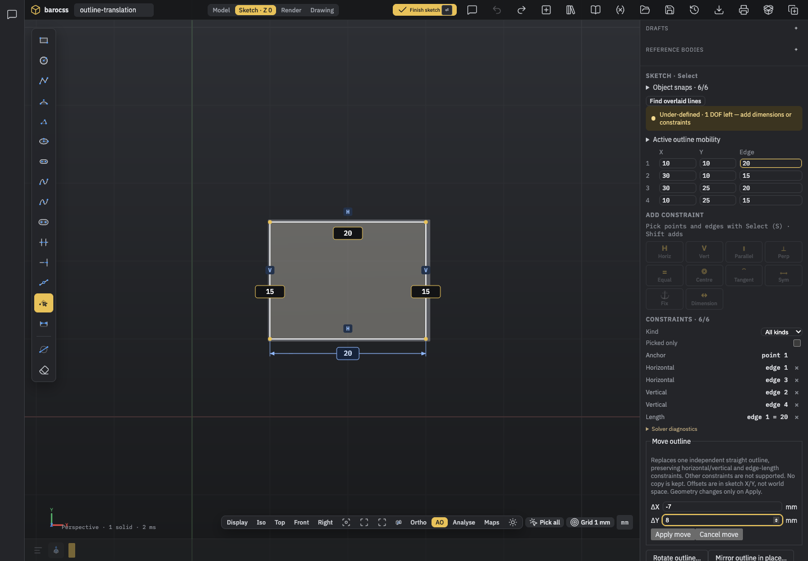
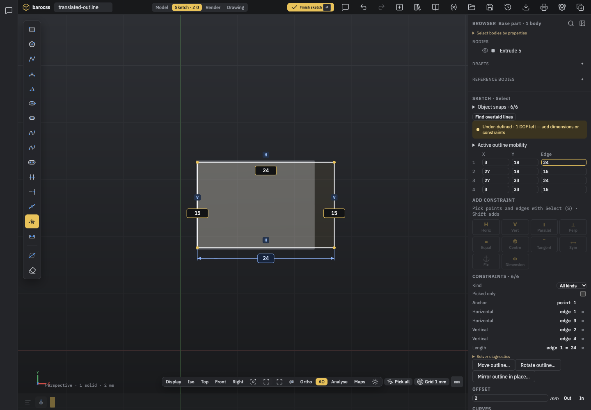

# Constraint-preserving sketch translation · #636 · 2026-11-17

One independent closed straight polygon (3–16 points) can now move by explicit sketch-local ΔX/ΔY. This replaces the outline, not a copy or permanent parametric Move feature. H/V, numeric edge lengths and indexed physical side IDs remain intact. Fixed points, other rules, curves/derived outlines, linked/band and multiple material outlines remain unsupported; nothing is silently unconstrained.

`translateOutline` reuses existing zero-rotation admission before and after the coordinate edit, plus exact-settle validation for constrained geometry. Displacements are finite values; the resulting coordinates, rather than the displacement, must fit the modeling range. Zero displacement returns the original shape after source admission. The UI owns its draft by sketch/document, uses existing action-time live-generation guards, and changes geometry only on Apply. No kernel, solver, schema or serialization change; all HOLD boundaries remain.

## Verification

- Focused `translate-outline mirror-outline rotate-outline outline-rotation-commit sketch-edit-identity constraints`: **87/87 PASS** after the final test addition.
- Studio tsc and scoped ESLint/diff checks PASS; production Vite build **6.13 s**.
- Independent static review: no blocker.
- Actual Chrome first execution PASS; frozen product sources, no runtime/console errors, clean browser/server shutdown.
- Mutation evidence: first pass killed 3/4. Removing translated-result admission survived because constrained cases were rejected by exact-settle. Added a free-outline out-of-range/huge-finite-result negative fixture. Final **4/4 killed**, before/after mutation baseline **25/25**, original product hash unchanged. This is a test-coverage finding, not a product-code defect.

## Actual workflow and independent oracles

H/V rectangle [(10,10),(30,10),(30,25),(10,25)] with driving edge 1=20 and Extrude height=5:

- Blank and out-of-range input refuse, Enter does not Finish; Escape and Cancel leave points/document unchanged.
- ΔX=5 then sketch Undo/Redo; Δ=(-7,+8) yields [(3,18),(23,18),(23,33),(3,33)]. No accepted-document edit before Finish.
- Finish preserves H/V, length and side tags. Native validity, eight extrusion vertices, shoelace area×5 volume, and each named wall's indexed endpoints pass.
- Document Undo/Redo, physical Save and fresh-context Open preserve the full document.
- Reopened edge 1 length20→24 yields [(3,18),(27,18),(27,33),(3,33)] and volume15×24×5. Existing Normal and fit sketch frames it. Undo/Redo and a **second Save/fresh Open** preserve the revised shape and length.
- Explicit document replacement retires a pending offset; fixed-point counterpart refuses without stripping its rule or modifying the accepted document.

Pixels inspected at 1440×1000. This is a focused straight-outline workflow, not full CAD/kernel certification. Tilted sketch-plane actual UI, curved/general-constrained translation and side-wall identity after width resizing were not qualified. Source winding/order is unchanged; named-wall checks apply to the translated pre-resize solid.

## Reproduce

After Studio production build, with Node22 and installed Chrome/Playwright:

```sh
cd apps/cad-studio
TRANSLATION_SOURCE_FROZEN=1 PW_DIR="$HOME/.cache/barocss-playwright" CHROME='/Applications/Google Chrome.app/Contents/MacOS/Google Chrome' node test/sketch-translation-browser.mjs /tmp/translation
```



