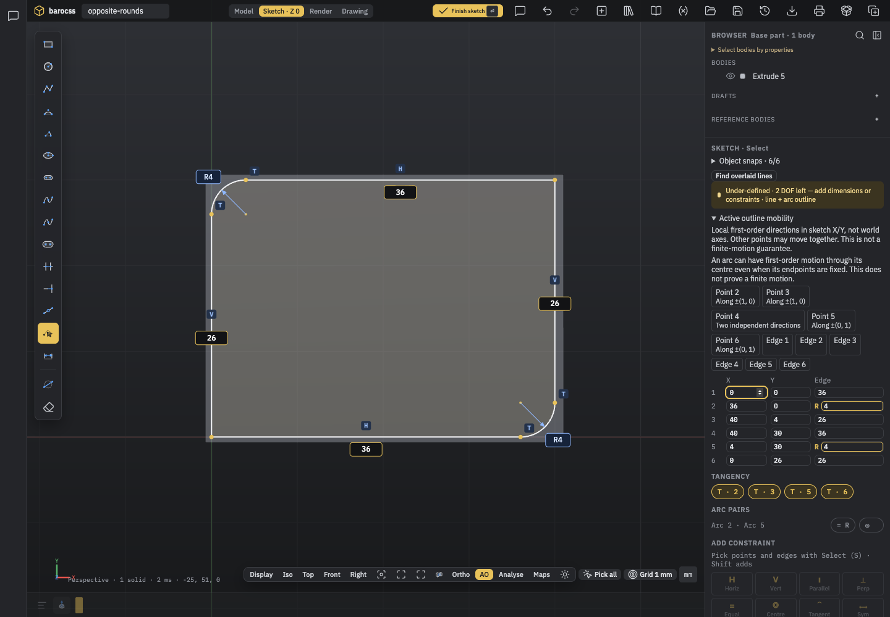
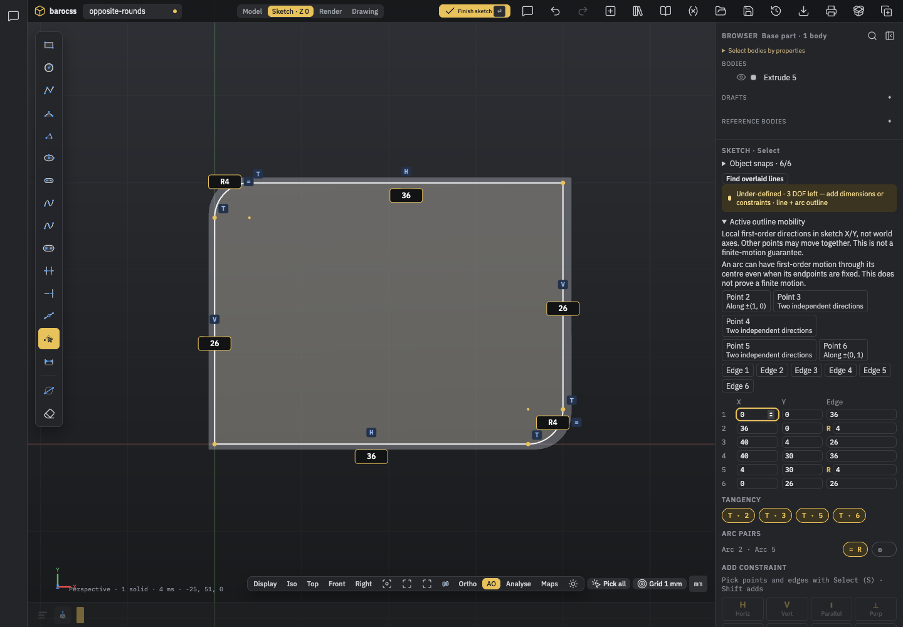

# Two nonadjacent arc mobility (#21)

Original baseline: 29ed1bed235bb993ba0e6756b2b358a0f3acb611. Actual Chrome 1440×1000.

## Scope

The existing residual-checked solver and arc-centre participation diagnosis already support multiple arcs. Admission now includes exactly two nonadjacent arcs on a single closed line/arc outline, with valid individual radius constraints, line–arc tangency and one canonical Equal radius pair. Every straight-only constraint excludes both arcs. Malformed/sparse metadata, adjacent or three-plus arcs, attached circles, concentric, spline/ellipse ownership remain unavailable.

This is local first-order participation, not independently controllable or finite motion. Equal radius may couple both arcs. No solver/profile, UI, viewport, saved format or authored geometry changes were made. Existing HOLDs remain; #21 stays OPEN.

## Actual baseline and fixed

Start with rectangle 40×30 extruded 5. Actual Select/Round at [40,0] and [0,30], R4 each, creates six points and two nonadjacent arcs. The Round operation itself changes geometry; subsequent diagnostic/constraint comparisons preserve that rounded geometry.

Both baseline and fixed exercised: remove both radius locks, explicitly add/remove Equal radius, draft Undo/Redo, restore R4, remove/restore a tangent, Finish, document Undo/Redo, physical Save/fresh Open and Escape. All passed. Existing Round adds radius and tangents, not an automatic Equal radius relation.

Fixed checks authored points 2–6 and edges 1–6; initial/restored directions X/X/2D/Y/Y. Existing diagnostic ranks remain 2 DOF with both R4, 4 after unlocking both and 3 with Equal radius. Hover/focus highlights and leave/blur cleanup pass without document changes. Coupled-motion disclaimer remains visible.

Independent native strict BRep, analytic volume `(1200 - 2*(16 - 4*pi))*5` and all twelve z=0/5 contact vertices pass. Baseline and fixed final .bcad files are byte-identical. Existing one-arc and attached-circle actual regressions pass.

## Tests and execution boundaries

- Straight, one-arc, circle and new two-arc focused tests: 21/21 PASS; scoped lint PASS.
- New numerical cases cover two centre-only motions, Equal coupling, one radius removing the coupled freedom, input/ordinary-solver invariance, malformed/unsupported metadata, unsatisfied residuals and singular/near-singular limits. Numerical cases are not extra browser coverage.
- Final Model TypeScript and Studio TypeScript/production build PASS (4.64 seconds), existing bundler warnings retained.
- Actual receipts show source frozen and contexts/browser/server closed. Final heavy slots returned; disk stayed above 35 GiB.

Failures retained:
1. Baseline01 completed actual save/reopen but used an old-context panel locator for the last Escape wait. FAIL; final dismissal verification NOT_RUN in that attempt. Only the locator was replaced with the current page locator; baseline02 fully PASS.
2. First final Model typecheck failed TS7022 on a new test-local motion variable. Actual flows already PASS; Studio types/build were NOT_RUN. Adding `PointMotion` type annotation only (no runtime change) restored 21/21/lint and final Model/Studio checks.

Driver: `sketch-two-arc-mobility-browser.mjs`, optional `--baseline`.

