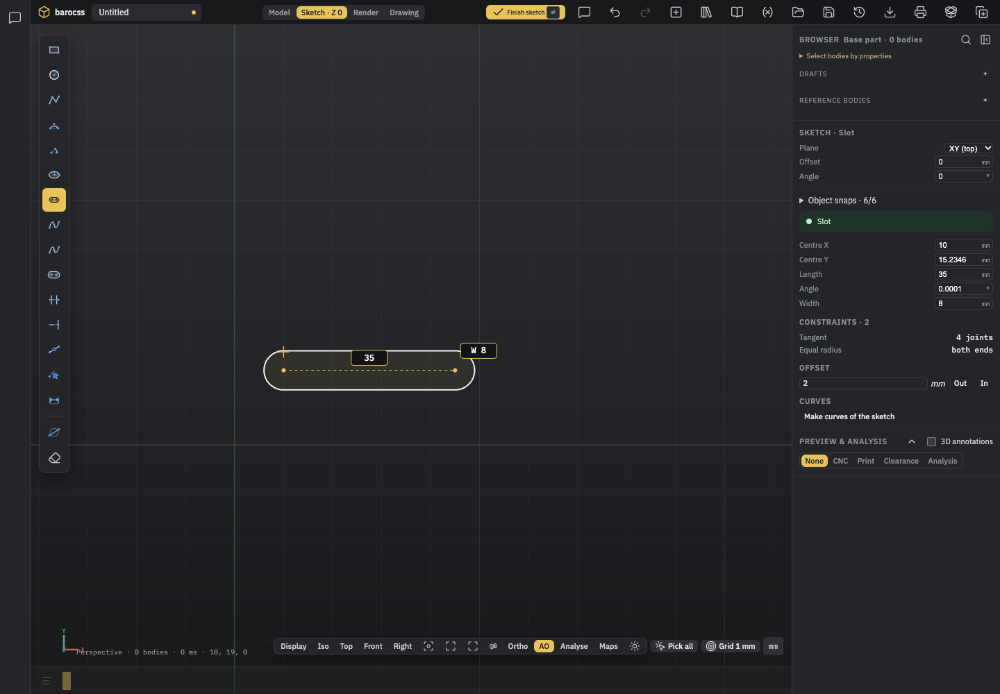
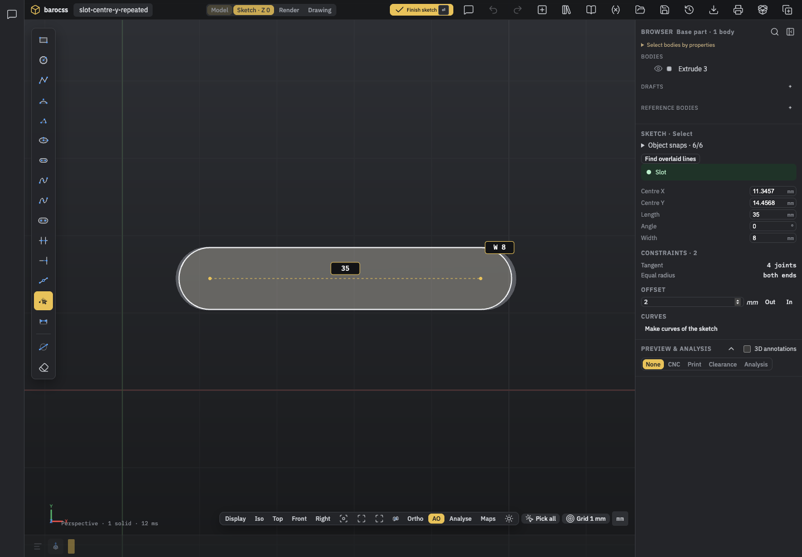

# #21: Slot centre movement preserves its shape

Limited existing-issue repair; broader #21 remains OPEN. No solver/schema/snap or document-sync change.

## Original failure
On original main 091366fef, create an XY Slot with arc centres [10,15]/[45,15], R4. Enter Centre X10.123456789: the first centre retains precision, but the second becomes45.1235. Native centre distance becomes35.000043211mm instead of35; extrusion H3 volume changes by+0.001037064mm³. Separately Centre Y15.234567891 saves the second Y15.2346, introducing a centre-vector Y error0.000032109mm. Both survive Save/fresh Open. Lifecycle execution PASS is not a precision pass: the original requested-translation checks are FAIL.

## Repair
Only Centre X/Y callbacks use an axis delta applied to both centres. The field still locates the first arc centre, not the entire Slot midpoint. Other axis, radius and metadata remain intact. Same input/nonfinite/overflow return the original object. Length/Angle/Width editing and displayed four-decimal formatting remain unchanged.

## Verification
- Focused3/3: horizontal fractional inputs, oblique repeated X/Y vector/length/angle and construction metadata preservation, source immutability, invalid/no-op.
- Actual Chrome fixed: independent X/Y entries, draft Undo/Redo, Finish/Extrude, document Undo/Redo, Save/fresh Open, Edit sketch and repeated opposite/first-axis moves, second Save/Open: PASS. Existing extrusion and side tags retained.
- Native10 observations: centre-distance and Y-direction error0; volume residual at most6.9e-13mm³. Two cylinder centres/radii, centroid, Z extent and strict BRep checked. Expected volume uses original L35, R4, H3: (2rL+πr²)h, not a re-derived distorted length.
- Existing slot-draft --reopen-slot browser: PASS, including Length/Width/Angle, draft history and post-reopen width editing.
- Model tsc and Studio tsc/Vite build PASS; existing bundler warnings only. ESLint/diff check PASS.
- Both actual runs source changes=[], errors=[], contexts/browser/server closed.

Actual browser qualification is horizontal XY Slots. Oblique preservation is unit-tested only. Extremely large-coordinate precision and other browser/DPI cases are not qualified. The separate Width/Length/Angle reconstruction behavior is not altered by this repair.

Driver: `SLOT_CENTRE_PRECISION_SOURCE_FROZEN=1 node apps/cad-studio/test/slot-centre-precision-browser.mjs OUTPUT`. Use `--baseline` only against original product. [Independent numeric comparison](native-comparison.json).

