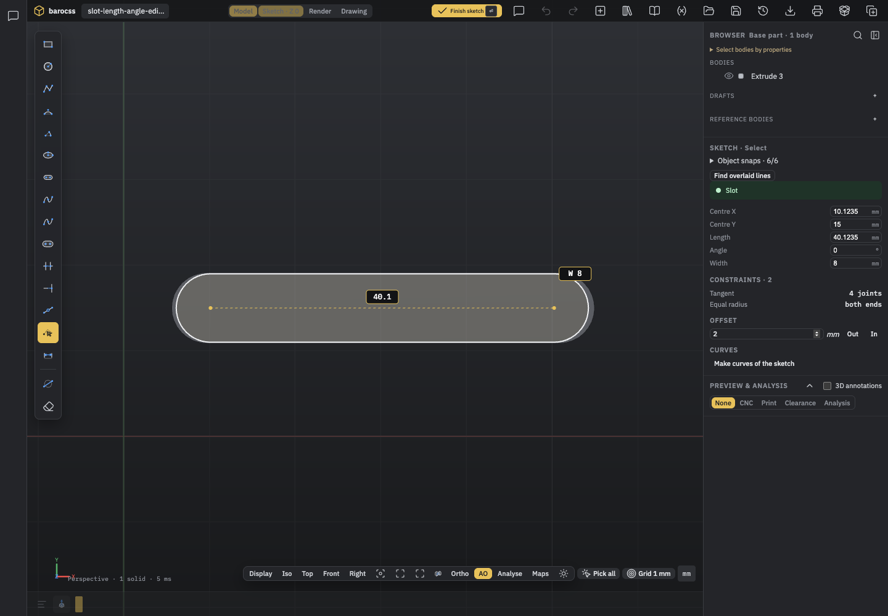
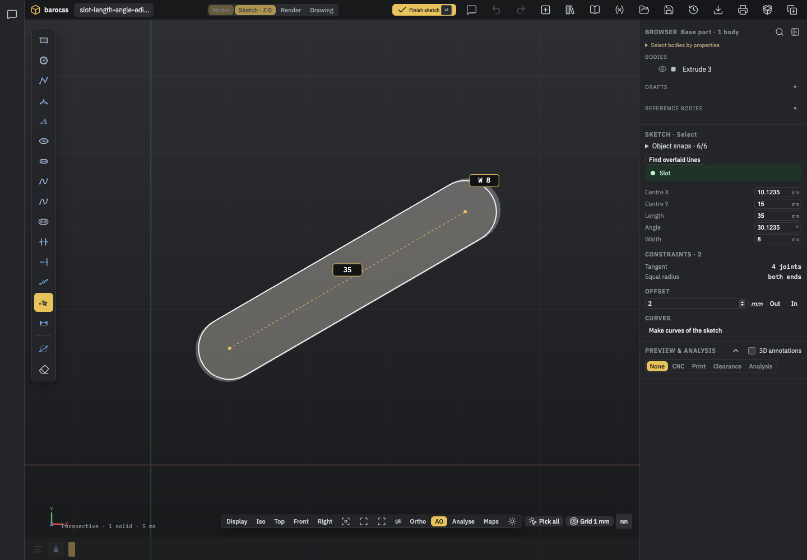

# Slot Length and Angle: preserve authored endpoint precision (#21)

## Baseline

Source commit: `dcdd300e8236027f75dd0095783f3a218dd7b979`.

Actual Chrome created an XY Slot with centres [10,15] and [45,15], radius4, then used the existing Centre X control to translate it to first centre [10.123456789,15]. Extrude3 and physical Save/fresh Open preceded the tested edit.

Both original flows completed native validation, draft/document Undo/Redo and Save/Open, but requested precision failed:

- Length40.123456789 stored second centre [50.2469,15], instead of the binary64 calculation [50.246913578000004,15]. Centre-distance error was −0.0000135780000079 mm; native volume error was −0.000325871999848 mm³.
- Angle30.123456789° stored [40.3966,32.5653], instead of [40.396567855789556,32.56527102944398]. Distance unintentionally increased by 0.0000423423131792 mm; native volume error was +0.00101621551687 mm³.

Lifecycle PASS is not requested-precision PASS. The rounded endpoint persisted through Save/Open; the issue was authored geometry, not merely displayed decimals.

## Change

Only the Slot Length/Angle endpoint reconstruction uses the new `slotEndpoint` helper. It computes the second centre without decimal rounding, preserving the first-centre object, radius and other metadata. Nonfinite input or overflowing computed coordinates retain the original shape. Existing Length minimum0.5, Angle finite-input handling, four-decimal display, Centre/Width helpers, snap policy, solver, draft history and file schema are unchanged.

This removes forced decimal quantization; it does not promise exact real-number trigonometry or eliminate binary64 rounding.

## Verification

- New endpoint4 + existing Centre3/Width2 focused tests: **9/9 PASS**. Fractional horizontal Length, oblique direction, repeated Length/Angle changes, metadata/first-centre preservation, minimum and zero-length pending behavior, nonfinite/overflow handling are covered.
- Initial focused result was 7/9: two assertions incorrectly required decimal-literal arithmetic to be bit-identical to binary64 sums. The independent decimal endpoint oracle now uses 1e-12 mm, and exact no-op identity uses an integer-coordinate fixture. No product geometry rounding was reintroduced.
- Actual fixed Length and Angle flows both PASS. First edits match independently calculated endpoints, centre distance, centroid, cylinder centres/radii and strict native solids. Intended native volumes are 1113.7594103083102 mm³ and 990.79644737231 mm³; measured differences were approximately ±2.27e-13 mm³.
- Each fixed flow repeats the same field after reopening: Length42.987654321 or Angle−20.987654321°. Draft/document Undo/Redo and another physical Save/fresh Open pass, preserving source tags, outputs and feature IDs.
- Existing Slot draft/reopen, Centre precision and Width precision actual regressions: **3/3 PASS**.
- All seven original/fixed/regression receipts report PASS, empty errors and owned context/browser/server cleanup. Original receipts separately report requestedPrecision FAIL.
- Scoped lint PASS. Coordinator reports Model and Studio type checks and production Vite build PASS (4.25 s).
- Actual runs used the working changes above baseline dcdd300e8. Coordinator subsequently fast-forwarded unrelated #207 work (0c8f96c79); product/fixture hashes stayed unchanged and the focused 9/9 suite passed again. Push and exact-commit CI remain pending at this record’s preparation.

Actual browser scope is the specified XY Slot and same-field repetition. Oblique Length and cross-field repeated edits are unit-only coverage. No manufacturing, general solver, topology or other-browser qualification. #21 remains OPEN; existing HOLDs are unchanged.

## Reproduce and provenance

Use the existing flow-helper setup with Node22, Playwright and Chrome. From the repository root:

```sh
SLOT_LENGTH_ANGLE_PRECISION_SOURCE_FROZEN=1 node apps/cad-studio/test/slot-length-angle-precision-browser.mjs OUTPUT_DIRECTORY
SLOT_LENGTH_ANGLE_PRECISION_SOURCE_FROZEN=1 node apps/cad-studio/test/slot-length-angle-precision-browser.mjs OUTPUT_DIRECTORY --angle
node apps/cad-studio/scripts/test.mjs slot-endpoint slot-width slot-centre
```

Use `--baseline` only with the original product source. Baseline fixture SHA256: `dab1ff17dfcdf83e630d397c6e482f1e8446ada3fc9cde41f9c815c547a2f169`. Fixed fixture SHA256: `3ef691e1a4c9dadacfde554d33e22b024eb335b52ac914183e447be7c6ee0709`.

Screenshots show the retained four-decimal display after reopening. Native and stored-coordinate assertions, not screenshot digits, establish precision. All geometry is synthetic.




