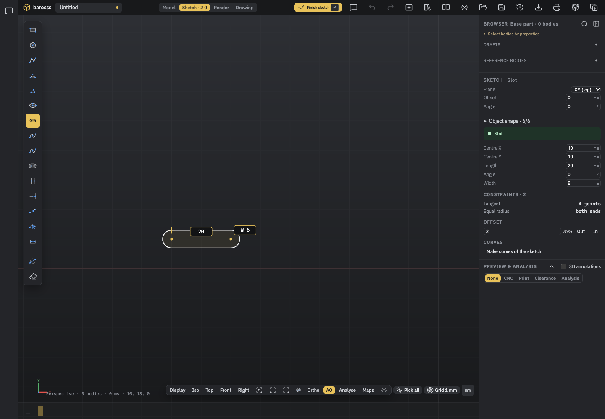
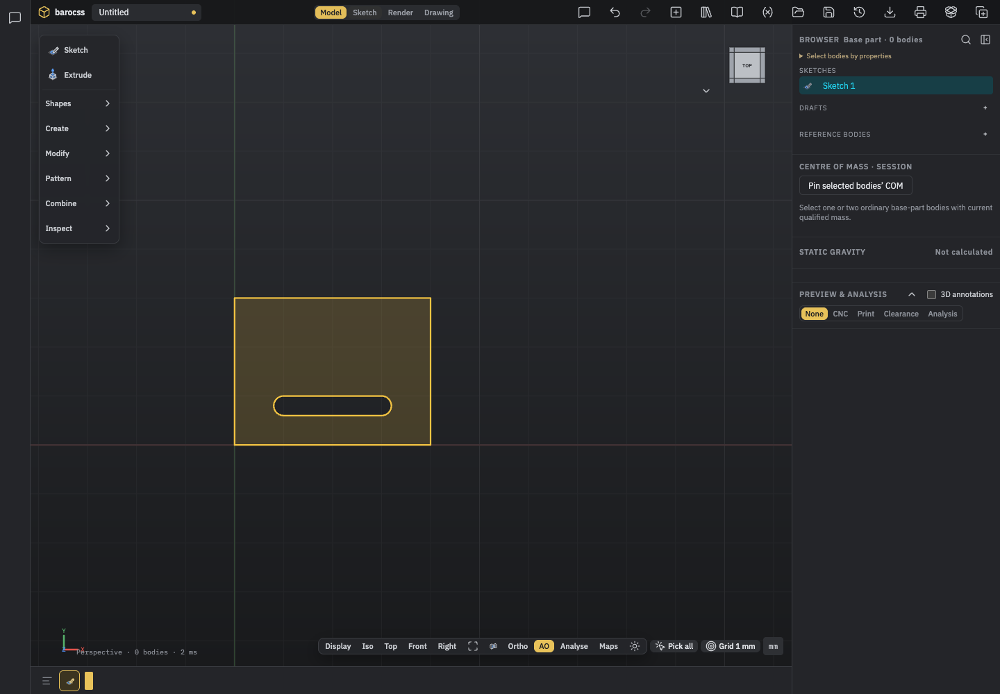
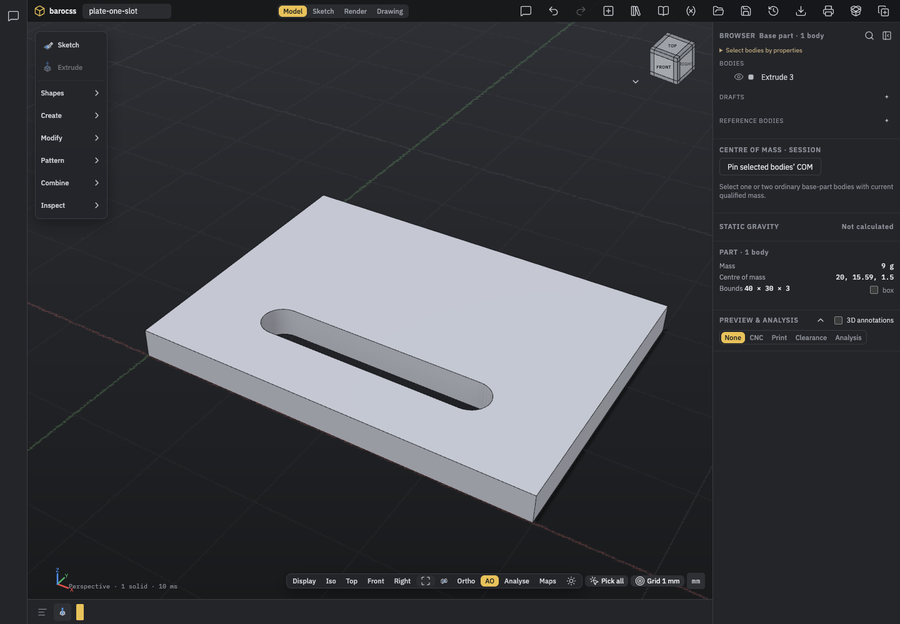

# Three-click Slot placement draft history (#667)

## Actual baseline and scope

On main70dff2df1, a completed Slot with centres [10,10]/[30,10] and width6 has Undo disabled. D1091/D1092 already support panel edits and reopening; pointer placement was explicitly outside that scope. Separate baseline confirms stage1 r0 is discarded by a tool change, stage2 r1 stays parked, and Escape preserves the accepted document. These policies are unchanged.

Start, intermediate previews (including the second centre) and third-click completion now share a kind/document/generation-owned transaction. Only completion records a whole-draft history entry, even when width equals the last preview. Same-centre second clicks still do not advance. Parking preserves exact Slot objects; ordered identity matching is limited to Rectangle/Circle/Slot tools and active kinds, with existing source metadata guards. No kernel, radius, snap or storage schema change.

## Verified

- Focused baseline7/12 PASS with5 expected failures; final related43/43 PASS. Changed-file lint and diff PASS. Independent source review found no blocker.
- Frozen actual Slot browser PASS: completed/repeated/construction placement, mixed Rectangle/Circle history, pending keyboard Undo/Redo in both stages without consuming earlier history, ignored same-centre click, stage1-drop/stage2-park policy, New part Keep in both stages then completion, Discard from a nonempty owner, fresh-owner history and Escape preservation.
- Actual plate workflow: rectangle40×30, first slot centres[10,8]/[30,8],r2, mistaken second slot atY22; Undo removes only the second slot. Finish records one hole. Extrude3, Undo/Redo and physical Save/fresh Open retain the first through-slot.
- Independent plate volume (1200−80−4π)×3 =3322.3008881569226mm³; native3322.3008881568967. Strict native B-rep valid; two inward cylindrical walls r2 at x10/30,y8, Z axes, and tangent vertices at y6/10,z0/3. Worker volume also agrees. Python independently recomputed the final analytic volume.
- Independent standalone Slot with centre distance20,r3,height4 has expected593.0973355292325mm³ and native593.0973355292323. Native boundary/end-plane checks, strict B-rep, Undo/Redo and physical Save/fresh Open PASS. Volume tolerance1e-7mm³, boundary1e-8mm.
- Existing actual Slot panel/reopen driver PASS, including reopened Width editing. Existing full Circle and Rectangle actual placement regression drivers PASS.
- Four final actual runs each preserved1,075 source files, no page/console errors, browser/server cleanup confirmed. Baseline and final screenshots visually reviewed. Studio TypeScript+Vite build PASS, Vite7.38s. Not a full repository suite claim.

## First fixture failure retained

Initial baseline requested width6 but observed4 and the Length field was focused: the midpoint width-click overlapped the dimension label. The fixture now clicks perpendicular to the first centre outside that label and asserts canvas hit before/after preview plus exact field values. Corrected baseline established Undo disabled. No tolerance was widened to hide a model dimension discrepancy, and object snapping was unchanged.

## Limits

Actual new placement coverage is horizontal XY positive-width slots; construction zero-radius intermediates and arbitrary external timing races are not newly qualified. Existing panel/reopen regression includes angled authored Slot. No ellipse, centre-arc, spline or broad curve placement history claim. Existing manufacturing/Physics/schema/fitter/UI HOLDs remain. Doc-sync stays paused; these are task-local receipts.

