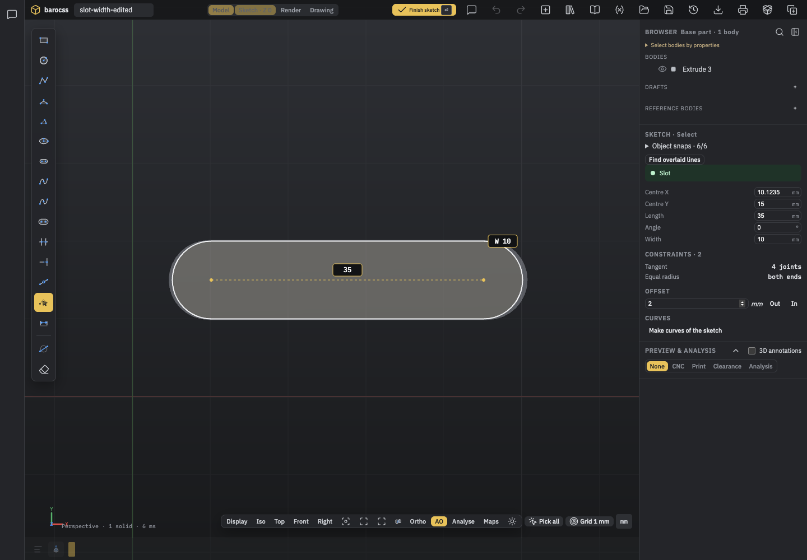

# #21: Slot Width preserves both authored centres

Limited precision repair; broader #21 remains OPEN. No Length/Angle, snap, solver, native capability, schema or document-sync changes.

## Original actual baseline
On main 596547415, create a horizontal XY Slot, move Centre X to 10.123456789, extrude H3 and Save/fresh Open. Both centres remain [10.123456789,15] and [45.123456789,15], radius4. Editing only Width8→10 reconstituted the second centre as [45.1235,15]. The centre distance became35.000043211mm and native volume1285.620745349234mm³ instead of the independent fixed-centre expectation1285.6194490192345mm³. This displacement persisted through Redo and another Save/fresh Open. Undo restored the original. Baseline lifecycle/native validity PASS is not requested precision PASS.

## Repair
The Width callback uses a radius-only update. It preserves both centre objects and metadata, retains the existing minimum radius0.25, and returns the original shape for unchanged or nonfinite input. Display rounding and existing Length/Angle reconstruction remain unchanged.

## Verification
- New width tests2/2 and existing centre tests3/3 PASS: fractional and oblique endpoints, repeated widths, construction metadata, frozen original, minimum radius, nonfinite/no-op.
- Actual fixed Chrome: initial Save/fresh Open, Width8→10, draft Undo/Redo, Finish, document Undo/Redo, second Save/fresh Open and reopened Slot controls PASS.
- Strict BRep, two native cylinder centres/radii, axis/Z extent, centroid and independently expected volume verified. All6 native observations have centre-distance error0; maximum volume residual2.3e-13mm³.
- Existing slot-draft --reopen-slot browser PASS, including Length/Angle/Width editing and draft history.
- Model tsc, Studio tsc/Vite build, ESLint and diff check PASS. Existing bundler warnings only.
- Both browser runs errors=[], changes=[], all contexts/browser/server closed. Actual reopened screenshot visually checked.

Actual qualification is the horizontal XY case above. Oblique endpoint preservation is unit-tested, not a new browser qualification. The screenshot retains four-decimal UI formatting and alone cannot demonstrate the small native difference; see the [numeric before/after evidence](native-comparison.json).

Run: `SLOT_WIDTH_PRECISION_SOURCE_FROZEN=1 node apps/cad-studio/test/slot-width-precision-browser.mjs OUTPUT`; add `--baseline` only for the original product. Original observations remain separately recorded, never relabeled as a precision pass.

