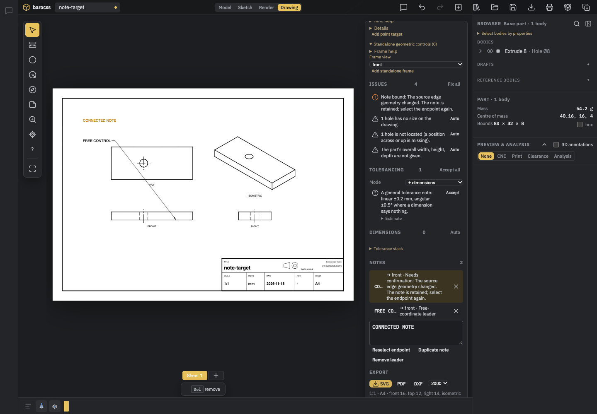
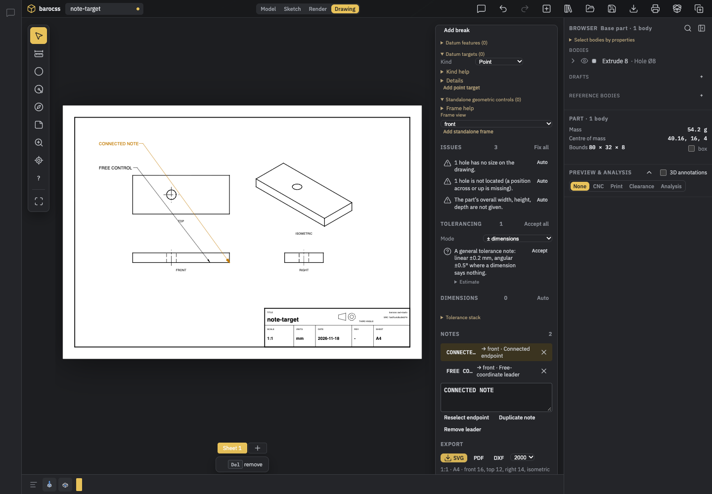

# #245: explicitly connected Note endpoints

Synthetic starter geometry only. Existing issue remains OPEN; this is bounded implementation, not general topology tracking.

## Contract
Existing paper and free-coordinate leader Notes retain their behavior. Attach to endpoint / Reselect endpoint connects a selected Note to a unique visible straight native edge endpoint in a current, unbroken front/top/right base-part view. Scoped parts/bodies and assembly are excluded. Overlapping endpoints require explicit choice. Saved `leader.target` includes the exact edge, min/max endpoint and source signature. A/B coordinate guessing and automatic nearest-edge replacement are not used.

Changed, missing, ambiguous, rematched, hidden or unsupported sources keep the Note text, ID, paper position and target, but suppress its leader and report a diagnostic. Explicit reselection updates only the connection. Hidden-to-visible restoration can restore an unchanged target; changed geometry is not automatically re-signed. Generic capture/refresh/rematch/confirm cannot silently repair Note targets. Scope changes retain existing reference guards.

Raw native and commit validation reject malformed targets, while legacy Notes remain free-coordinate. Reader/copy-on-write preserve independent target arrays. Reorientation preserves native target/signature and reprojects only; an edge hidden from the new side becomes unresolved. Schema3/4 unchanged, no migration. Shared sheet marks feed SVG/DXF/PDF; no new 3D Note support is claimed.

## Verified
- Model endpoint/reader/reference/reorientation/native-container suite **8/8 PASS**. Includes reversed endpoint ordering, misleading midpoint hint, changed/missing/duplicate/rematched source, hidden→visible restoration, unsupported scope, target copy-on-write and automatic-rebinding prevention.
- Actual Chrome **PASS**: explicit Attach and Escape cancellation; Width64→80 through public feature editor; changed target reports confirmation needed with no old arrow, free-coordinate control remains at64; explicit endpoint repair points to80; Undo/Redo; actual native Save→fresh context Open; post-Open Remove leader/Undo. Document comparisons preserve Note text/placement and unrelated free Note.
- Four actual SVG downloads parsed independently with Python XML/arithmetic: connected/unresolved/reselected/reopened. Bound arrow tips match native width, unresolved output has no bound lines/arrows, free control remains at its prior view coordinate. Oracle uses actual layout box/scale from the existing test hook; it is **not** independent layout computation. No product resolver is used as the tip oracle.
- Actual unresolved and reselected screenshots reviewed. Diagnostics and recovery controls remain readable; row titles use existing ellipsis, full selected text remains in editor.
- Related Model regressions **85/86**. One old `drawing-sheets` plain PDF golden fails identically with HEAD source overlay (**26/27**): actual `533e64765f48aeac1d244bc20b3aad7551feb08349b8d06ab1a69b619d5e4b66`, expected `d280596ee08f569553b20d08e72673421cb58fed919f1e0917128369a1dcd081`. Goldens unchanged.
- Studio commit/roundtrip **7/7**, final Model and Studio type checks PASS. Lint has only existing DrawingWorkspace unused DrawingFix/_leader/_sheet errors; no clean-lint claim.
- Initial reorientation fixture incorrectly required an edge to stay visible from the opposite side. Corrected to actual top→top visible positive and front→reverse-side hidden negative. Fixture-only tuple/inference errors corrected with explicit types. Final8/8 and types pass; these were not product failures.
- Browser source changes, page/console errors empty; two contexts, browser and server closed. Final diff-check PASS;36GiB free.

## Remaining acceptance and HOLD
Actual UI qualifies one base-part front endpoint and one free leader, not arbitrary topology, scoped parts, assemblies, multiple sheets, stale Worker/callback interruption, units/scale breadth or arbitrary view changes. Escape is one actual Cancel path; other owner guards are source-reviewed, not a complete actual race matrix. Native project container is unit roundtrip, actual UI uses native Save/Open. Actual DXF/PDF file qualification and new Note 3D display remain unqualified. SVG/DXF output does not carry native CAD associativity. Existing PDF, schema5, owner redesign, manufacturing/Physics, new GPU CI and deployment HOLDs remain.

## Reproduce
Model: `node scripts/test.mjs drawing-note-targets drawing.test drawing-sheets drawing-issues referencesCopy drawing-datum-targets` (one known baseline PDF failure).
Studio: `node scripts/test.mjs drawing-note-target-commit drawing-commit-roundtrip`.
Type-check both Model and Studio with their tsconfig.
Root with PW_DIR/CHROME configured: `DRAWING_NOTE_TARGET_FROZEN=1 node apps/cad-studio/test/drawing-note-target-browser.mjs <fresh-output-directory>`.

