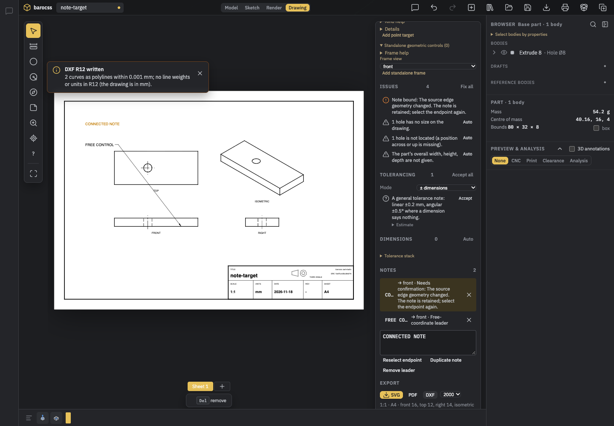
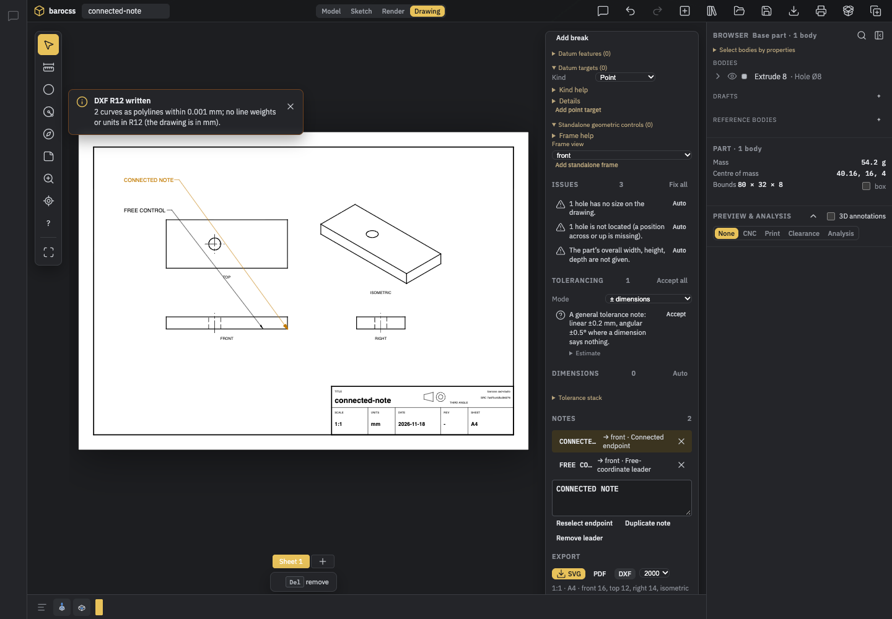

# #245: actual DXF Note display lifecycle

Test/evidence only, based on main `4705e89316f2618e461e5390763daba81aa7b832`. Existing issue remains OPEN. Synthetic starter geometry and synthetic Note strings only; no customer file or credentials.

## Verified
- Actual Chrome public Attach, Width64→80 edit, explicit Reselect, Undo/Redo, native Save and fresh-context Open.
- Four lifecycle states × R12/2000: **8 original downloaded DXF files** retained here alongside four SVG downloads. Independent installed ezdxf1.4.5 read/audit PASS; no audit errors/fixes. Reader never saves or repairs the product files.
- Independent XML/ezdxf TEXT, LINE and SOLID multiset comparison, with paper y converted by H−y. Native arrow-tip expectation uses width64/80, actual layout box and scale from the existing hook; layout itself is not independently computed.
- Changed source retains bound Note text, but exports zero bound leader lines/arrows. Legacy free-coordinate Note remains at64. Explicit repair and reopened state point to80. Extra/duplicate/orphan THIN lines and arrowheads fail this fixture's exact multiset checks.
- Each export stage preserves the accepted document. Native Save/Open preserves target/signature; this is separate from DXF semantics.
- Actual unresolved and reopened screenshots visually checked. JS syntax, Python AST, scoped ESLint and diff-check PASS. Source changes/page/console errors empty. Two contexts, browser and server closed;36GiB free after execution.
- Independent review found a missing leftover-LINE assertion before execution; corrected and re-reviewed. No product failure or product-code change.

## Limits
DXF Notes are flattened TEXT/LINE/SOLID primitives, **not** associative LEADER/MLEADER. They carry no native target, signature or Note ID. No editable reference roundtrip, downstream GUI renderer or DXF regeneration claim. TITLE_BLOCK is excluded from the modelspace Note oracle. This synthetic fixture has no other THIN modelspace lines; the oracle is not a general DXF validator.

One base-part front view only. Multisheet, arbitrary topology, assemblies/scoped parts, stale Worker interleavings and PDF remain unqualified. Existing plain PDF golden and DrawingWorkspace three unused-symbol lint failures remain known baseline limitations; this test-only change does not rerun or fix them. Existing HOLDs unchanged.

## Reproduce
Run `DRAWING_NOTE_TARGET_FROZEN=1 node apps/cad-studio/test/drawing-note-target-browser.mjs <fresh output>` with PW_DIR/CHROME configured and the installed ezdxf interpreter. The driver downloads product files, invokes `drawing-note-target-reader.py`, preserves parser input/output/exit hashes, and closes all resources. Full local receipts remain in the execution artifact directory; the committed reader summary uses relative artifact paths.

