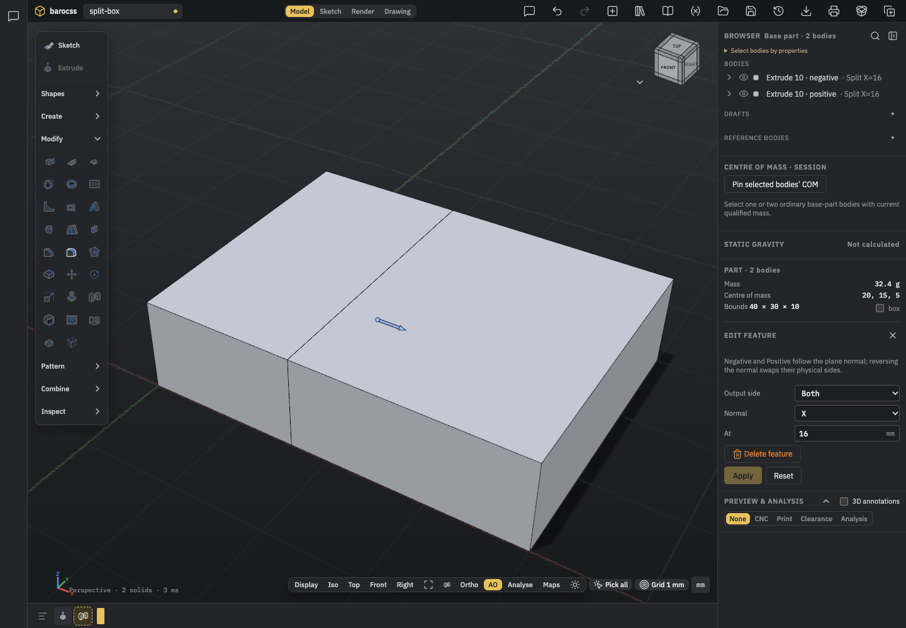
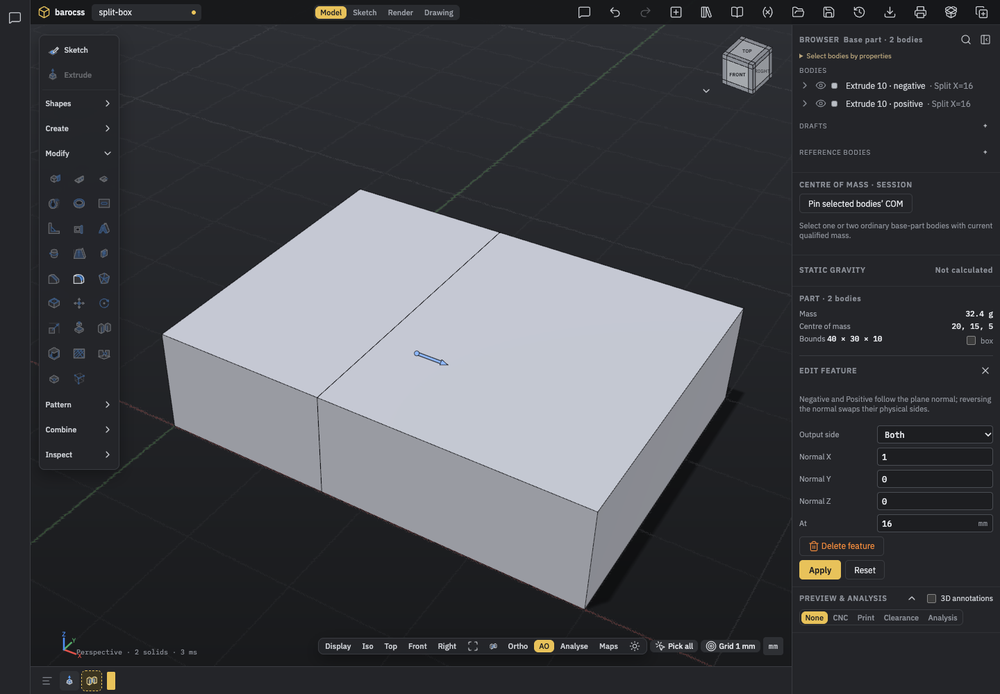
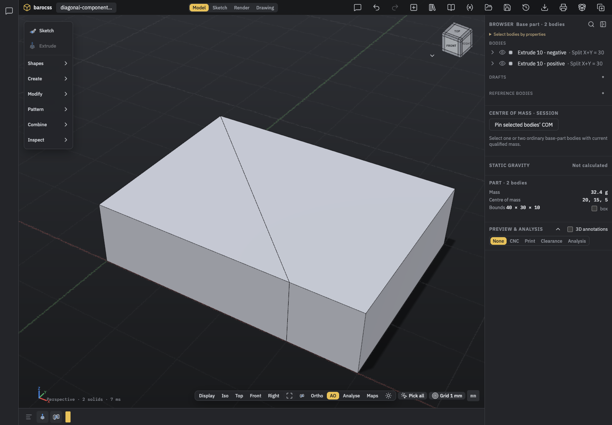

# Split normal components (#723)

History Normal → Any direction now explicitly turns a saved positive cardinal axis into its identical unit normal. At, parent, output side, node ID, outputs and all other inputs remain unchanged. Normal X/Y/Z then use existing History numeric editing. Reset/Cancel and Undo restore the original representation. The generic command drag HUD remains unchanged.

## Bounds and meaning
Only a terminal three-node numeric plain rectangle/extrusion/Split document without Direct or metadata/reference consumers is admitted. Identity and canonical-revision checks guard the captured draft. The setter rechecks admission; defined Direct, downstream, bound/nonfinite At, malformed/duplicate identity, invalid parent and stale/foreign arrays are excluded.

The native equation is n dot p = At, not a normalized distance silently substituted by this edit. Positive unit axis conversion preserves exactly the cutting plane and Negative/Positive meaning. Existing explicit negative normals may swap sides, and existing oblique edits may change topology. No downstream rematch or new splitting-kernel contract is claimed.

## Actual and numerical evidence
40×30×10 box, X=16: Negative4800 and Positive7200, centroids[8,15,5]/[28,15,5], eight corners each, original cap names/directions. Component conversion produces identical native outputs. Explicit follow-up n=[1,1,0], At30 gives4500/7500, centroids[10,10,5]/[26,18,5], independent6/8corner matching and cap plane equations. Cancel, Apply, Undo/Redo, Save/fresh Open and re-edit pass. Zero normal is blocked without mutation; outside At100 native refusal preserves the accepted document and Reset restores it.

Focused13/13 covers X/Y/Z × Both/Negative/Positive, file roundtrip, stale/admission boundaries and History/HUD separation. Existing Split side regression passes, including negative/positive/both, downstream side protection, moved side and explicit normal reversal. Model types, Studio types+Vite build, scoped ESLint and diff-check pass. verification.json preserves original failures and NOT_RUN boundaries. Exact CI/public rendering completion is recorded on #723. No HOLD lifted; doc-sync remains paused.

