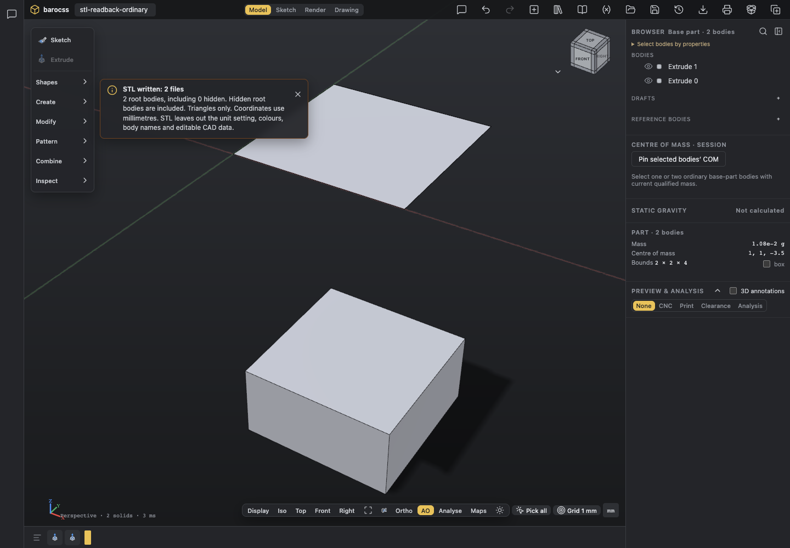
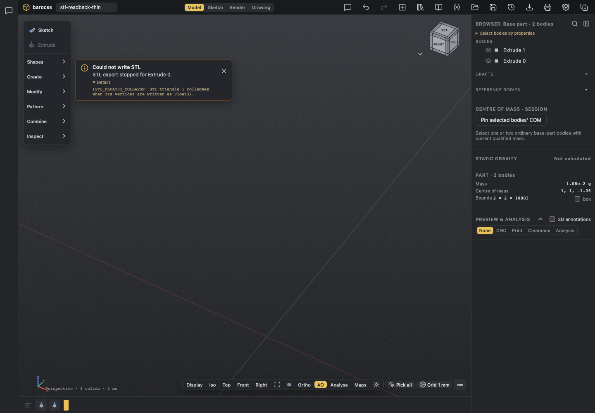

# STL actual-download readback qualification

Issue [#279](https://github.com/barocss/cad/issues/279). Test/evidence only; no product behavior or format change. Parent `762394f2124b409c48dd5dbe4dce43341f98a8ec`. Run 2026-11-17 UTC.

## What is new

D681/D729 captured Blob bytes at the download boundary. This run leaves Blob URLs, anchor clicks and Worker messages untouched. Chrome actually emits download events; Playwright `download.saveAs` persists each artifact, checks `download.failure() === null`, and a separate Python process opens the saved STL files directly. It does not consume producer buffers or reuse the encoder's validator. Files are saved in the external run directory, not a user's default Downloads directory.

The self-authored native fixtures contain a 2 × 2 × 1 mm prism at z = −4 and a 2 × 2 × 1/4096 mm prism. The ordinary thin prism starts at z = 0; the refusal witness starts at z = 9999. These are synthetic boundary fixtures, not representative finished industrial parts or a manufacturing qualification.

## Observed result

- **PASS:** Ordinary Automatic export produces two real 684-byte STL downloads and a 242-byte source sidecar. Python `struct` readback confirms 12 facets per STL, exactly eight expected world-coordinate vertices, finite stored values, nonzero facet areas, unit normals aligned with winding, zero attribute fields, and signed volumes 4 and approximately 0.0009765625 mm³. Sidecar file names agree with the downloaded STL names.
- **PASS:** Witness Automatic and Fine 32 each report `STL_FLOAT32_COLLAPSE`. No download events or saved files occur for either refused operation (through completion plus a 1000 ms observation window). All three earlier saved artifacts retain their SHA-256 hashes; the accepted document and history labels remain identical.
- **PASS:** Public Open of the ordinary control after both refusals, followed by Fine 32 export, produces three real downloads again. Independent readback passes again and both STL hashes and the sidecar hash match the first export.
- **PASS:** First actual execution, four UI states, six completed downloads, two independent oracle runs. 536 frozen inputs unchanged before/after cleanup. No page errors, console errors or watched file changes. Context, browser and Vite server closed normally. Node syntax, scoped ESLint and `git diff --check` pass.
- **NOT_RUN:** Genuine unavailable Worker fallback, touching-lump download path, delayed replies/Cancel, native Save/fresh Open in this run, third-party slicer, OS save dialog/default Downloads workflow, mobile, full suites and manufacturing/topology certification. Earlier bounded qualifications remain separate; they are not rerun by this test. #279 stays open for remaining qualification, notably genuine fallback.

This driver uses real UI Open and Export controls with readonly Studio document/body hooks for accepted-state checks. The supplied control STL/sidecar files are the first actual downloads. The second run files remain in the external receipt; both readback results and the sanitized receipt are included here. Sidecar revision/digest semantics are not independently reimplemented.

## Actual Studio screenshots

These are unmodified screenshots from the actual Chrome/WebGPU test showing synthetic geometry. They are **not AI-generated concept images**. The ordinary frame shows both prisms and export success. The refusal frame shows the precision diagnostic; the far-separated witness does not provide a useful visual geometry inspection at that camera position. Numerical assertions, not screenshots, establish file correctness.





## Reproduce

Use existing Node 22.19.0, Playwright and Chrome, a clean isolated checkout and the shared heavy gate. No dependency install or product build was added. Set `PW_DIR` to the existing Playwright package and `CHROME` to the local Chrome executable. `OUTPUT` must be a new absolute directory outside the repo; repeated reuse fails rather than overwriting prior downloads.

```sh
node --check apps/cad-studio/test/stl-download-readback-browser.mjs
./node_modules/.bin/eslint apps/cad-studio/test/stl-download-readback-browser.mjs
cd apps/cad-studio
STL_DOWNLOAD_FROZEN=1 node test/stl-download-readback-browser.mjs "$OUTPUT"
```

Raw external receipt also retains source hashes, oracle script, per-invocation stdin/stdout/exit custody, screenshots and saved files. No private models, user data or credentials are included.
