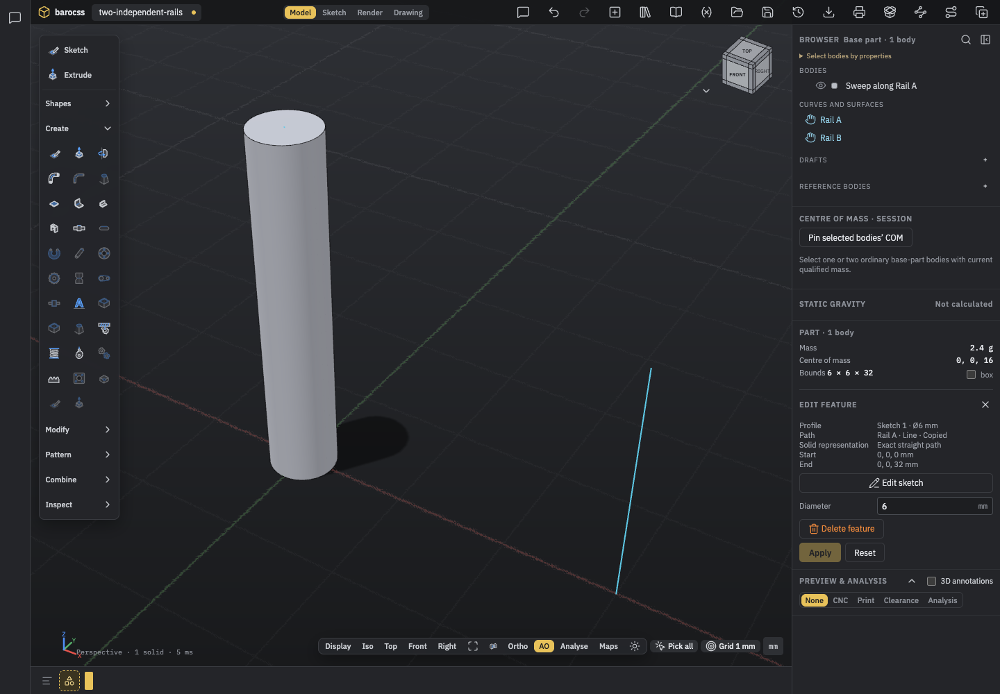
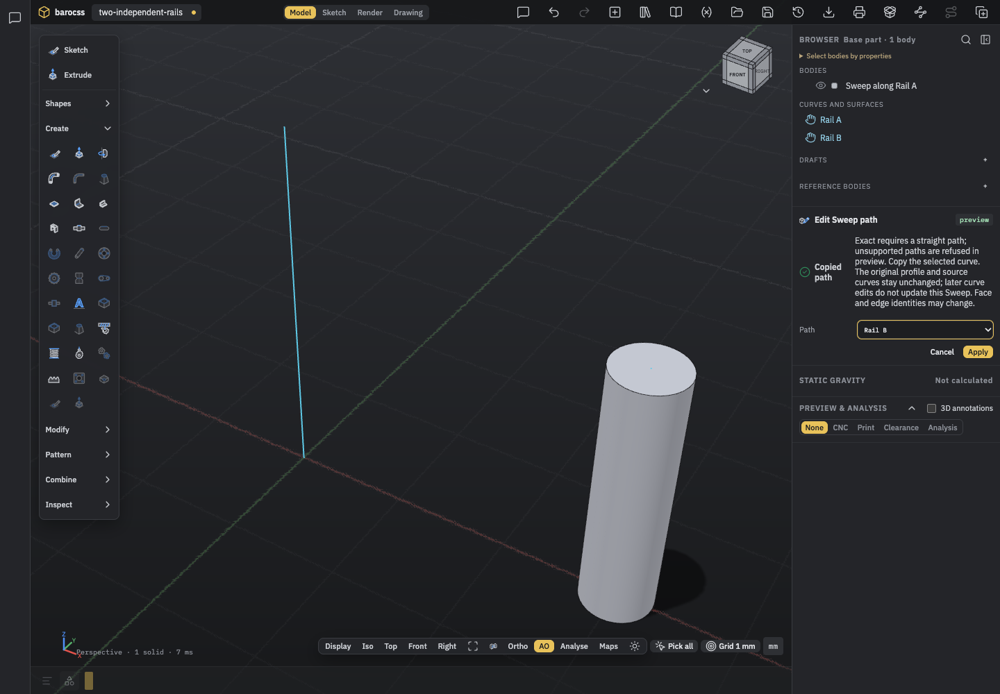
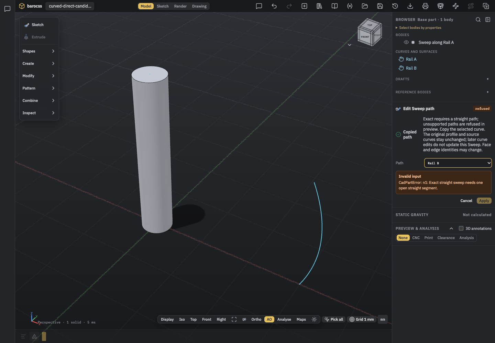

# Saved exact-straight Sweep copied-path replacement (#733)

A separate **Edit Sweep path** History action copies a selected current Direct curve into an unpublished terminal exact-straight disk Sweep. The existing Representation command is unchanged and remains a separate action. Only path/name change; profile, mode, IDs, outputs and Direct sources remain unchanged. The stored path remains a snapshot, not a live reference.

Scope: exactly one independent numeric circle plus a terminal exact-straight Sweep. Candidate object/source/geometry IDs, metadata and world-mm units are checked. Hidden/trimmed/transformed/ambiguous/unsupported sources are excluded. Structural candidates use the existing exact native admission during preview; no fitting or schema change. Both accepted and candidate results must be one strict valid positive-volume solid. UI uses existing owner/evaluation/worker guards and command identity/revision validation.

## Verified
- Product-unchanged actual Rail A creation, read-only History path, Undo/Redo and Save/fresh Open: PASS.
- Actual A→B→A path copying, Cancel, kind/profile/mode/source/ID preservation, Undo/Redo and Save/fresh Open: PASS.
- Rail A cylinder: R3, length32, volume288π, centroid[0,0,16], caps z0/32. Rail B: R3, length22, volume198π, centroid[30,0,11], caps z0/22. Strict native BRep, surface and vertex checks are independent of pixels.
- Direct Rail A changed separately: saved A cylinder stays unchanged and explicit B replacement works, including Undo/Redo/reopen.
- Noncollinear degree-two Rail B candidate is refused by native preview, Apply disabled, document/history preserved. Cancel and Save/fresh Open retain the accepted cylinder.
- Existing Sweep representation actual regression PASS. New+existing focused tests14/14, scoped lint, Model types and Studio tsc/Vite build PASS. All actual drivers frozen; browser/server cleanup completed. Screenshots inspected.
- Native proof is not run for every candidate during render; it stays in preview/build. No general curve/topology/downstream/HOLD claim. Exact CI/public image confirmation is recorded in final issue comment.

