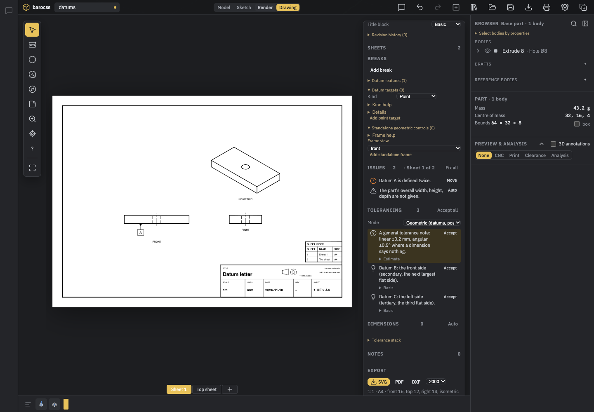
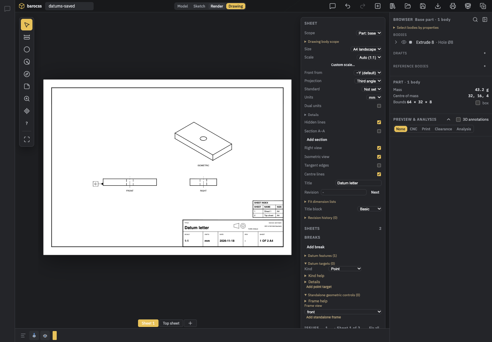
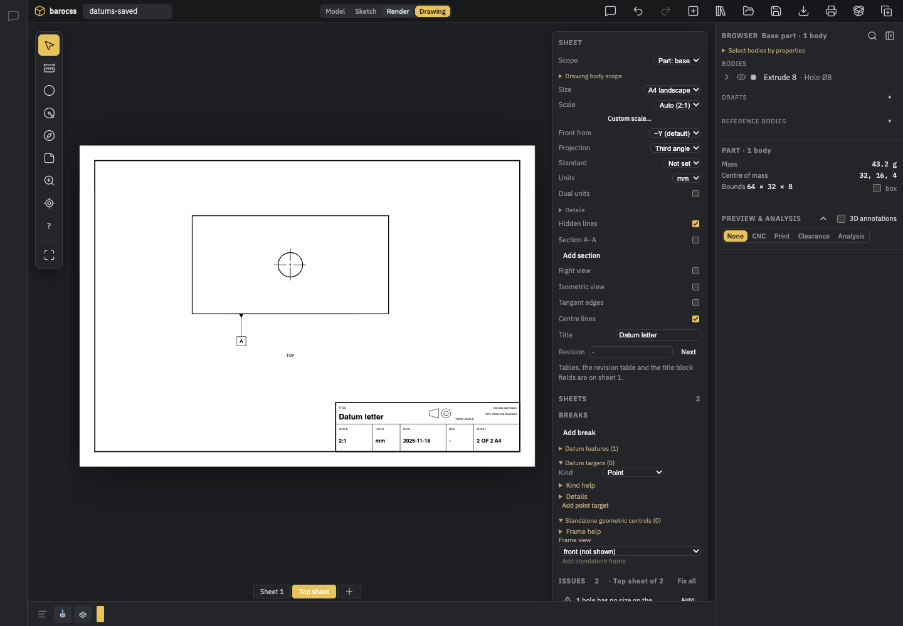

# Drawing-wide datum feature letters (#691)

Actual baseline d8b070777: valid authored Top-sheet datum A (user-top-A) exists. On Sheet 1, Accept Datum A creates a distinct front datum-A and the UI immediately reports “Datum A is defined twice.” Both records remain stored. This is a different boundary from #657's ID collision/overwrite.

The one-line fix recognizes existing global datum features through sheetContext.datumFirst together with the current local list. It neither rewrites old data nor uses datumLetters (which includes target sets). Existing target-only semantics, stored duplicates, geometry, IDs and source references stay unchanged.

## Verification
- Focused tolerance + datum-letter/datum-ID/frame-ID tests: 15/15 PASS. Other-sheet A no longer offered, C remains available; acceptAll retains original A and produces no DATUM_TWICE; single-sheet and target-only behavior unchanged; saved duplicate records retained. A separate dimensioned fixture confirms new position frames still name the existing A on another sheet.
- Scoped lint PASS, Studio tsc --noEmit PASS; read-only review no blocker.
- Frozen actual Chrome baseline FAIL as expected after real Accept, showing two A definitions and error.
- Fixed Chrome PASS: no duplicate A proposal, real C acceptance, unchanged original A, Undo/Redo, native Save/fresh Open, both sheet rendering. Receipt changes=[] and two contexts/browser/server closed.
- This fixture intentionally has no dimensions, so the existing overall-dimension warning remains. It is not a complete manufacturing drawing approval. Position frame cross-sheet reference is covered separately in the focused test, not claimed as the browser scenario.
- Disk available 15 GiB at completion. Existing PDF golden and HOLD scopes unchanged; no whole-suite claim.

