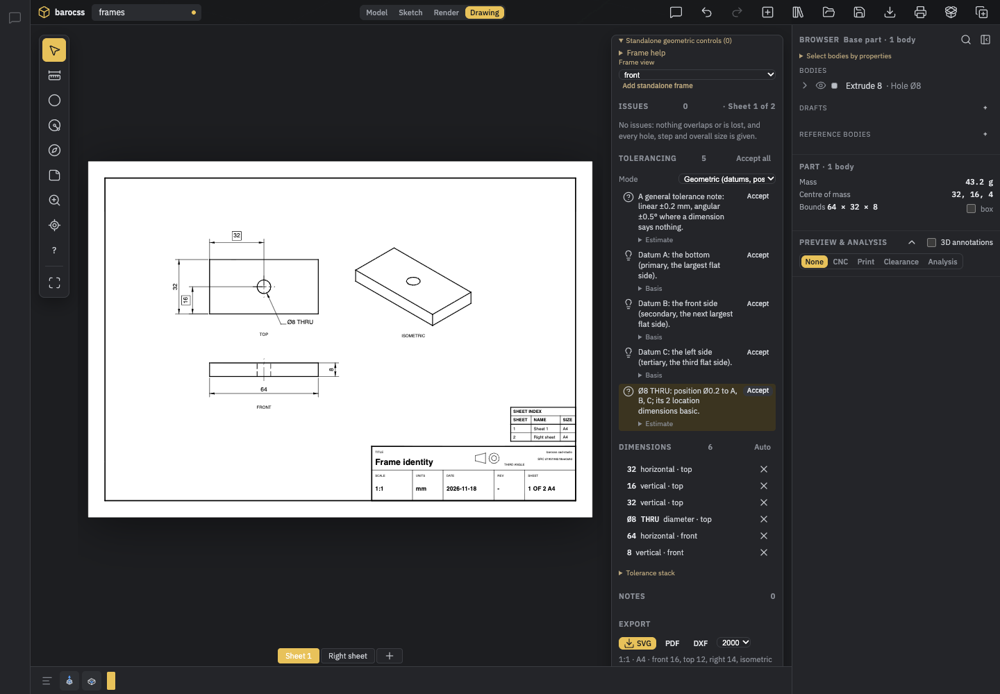
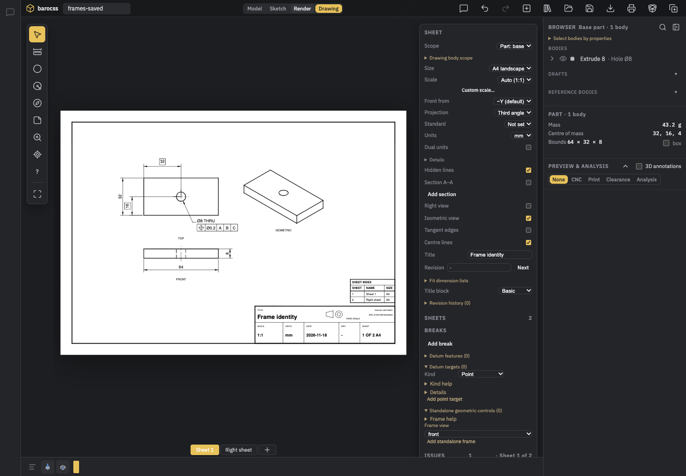
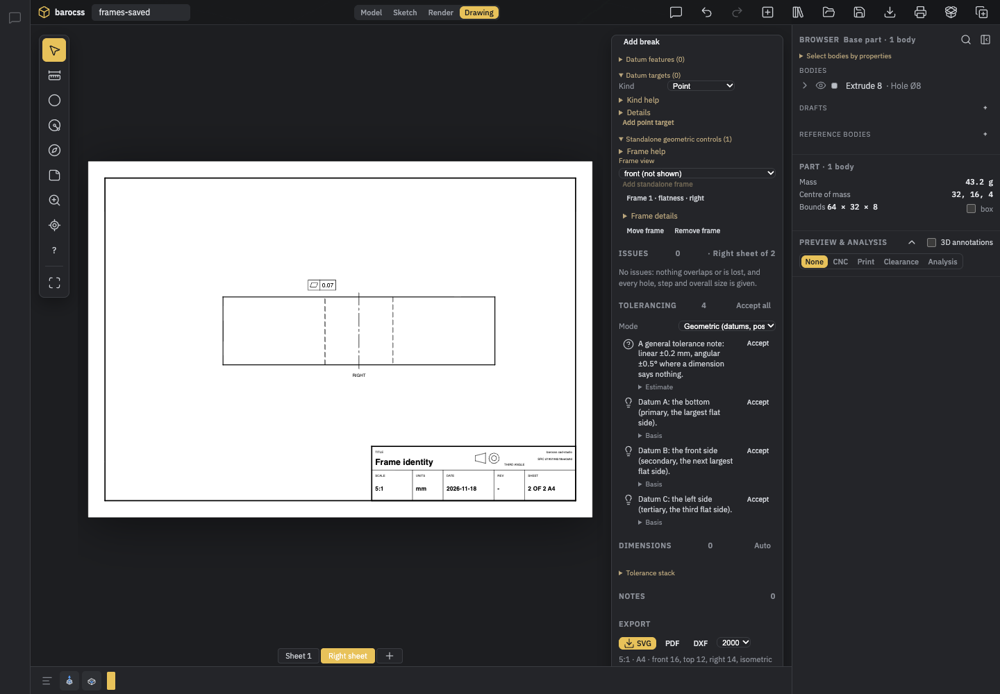

# Automatic position-frame identity (#689)

Baseline d8840e7d8: another sheet owns standalone flatness frame-d4, value 0.07. Clicking the first-sheet automatic position proposal for dimension d4 makes the location dimensions basic but the frame disappears during canonical normalization. The same proposal remains visible. The existing frame is not deleted.

The bounded fix reserves whole-drawing frame IDs in ephemeral SheetContext and combines them with the evolving local IDs. It does not rewrite old IDs, dimensions, references, values, duplicate-data handling, or the separate 200-frame input bound. Context does not persist. #645 addressed the different manual FrameEditor path.

## Verification
- Focused tolerance, frame/note/datum identity tests: 15/15 PASS. Collision suffix -3, acceptAll, old frames, dim/basic, single-sheet output and pre-existing duplicates covered.
- Scoped ESLint PASS; Studio tsc --noEmit PASS; read-only review no blocker.
- Actual Chrome baseline FAIL at frame count 1 rather than 2, preserved in receipt.
- fixed01 passed Accept, Undo/Redo and Save/Open, then failed the extra second-sheet SVG assertion: the fixture inherited autoLayout's hidden Right view. This was a fixture coverage problem, not an observed data-loss regression. Product source unchanged for fixed02; fixture explicitly shows all standard views and waits for sheet rendering.
- fixed02 PASS: frame-d4-2 position 0.2 plus unchanged frame-d4 flatness 0.07, Undo/Redo, native Save/fresh Open, both actual SVG downloads and both sheet screenshots. Original source geometry remains unchanged. Datums A/B/C are proposed but intentionally not accepted in this narrow frame-ID fixture; the existing missing-datum diagnostic is expected, not a manufacturing approval.
- Frozen source changes []; two contexts, browser and Vite server closed. Disk 18 GiB available at completion.

This is focused verification, not a whole-CAD or PDF golden-suite claim. Existing HOLDs unchanged.

