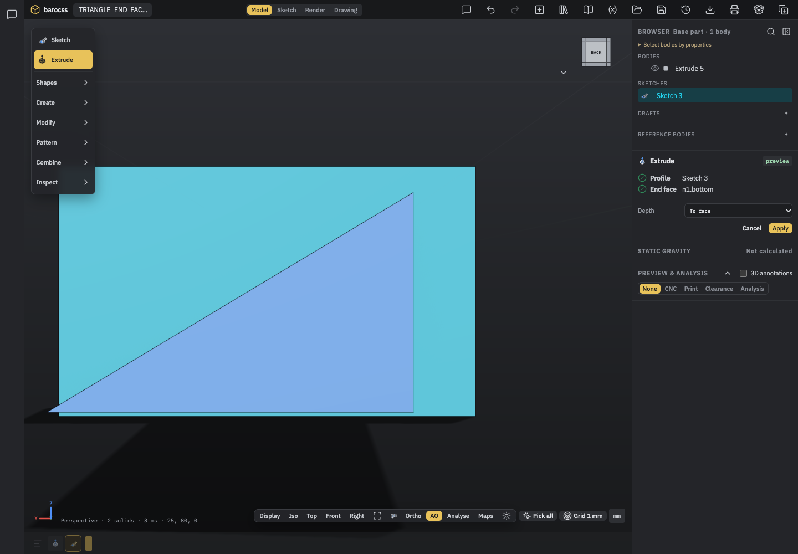
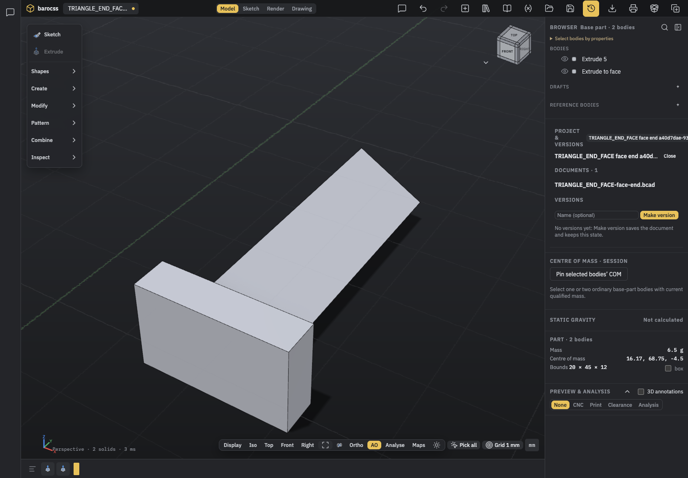

# Triangular support to an original target face · #638 · 2026-11-17

## Scope

A three-point straight triangular support/rib can now use the existing To face Extrude recipe instead of copying a target's current distance. The target remains one earlier current exact solid's opposing rectangular planar face. The triangle footprint must fit entirely inside that convex rectangle. Exact XY, YZ and Front XZ frames reuse their existing signed mapping.

Only finite literal triangle points are admitted, with every edge above linearTolerance and minimum altitude above linearTolerance. `node.points` is the actual native geometry authority; its bounds are used for containment. Optional editor outline points must be identical in order. Curved/derived/attached-circle metadata is refused, and malformed optional collections safely return false rather than throwing in UI capability checks. Existing H/V, lengths and rules retain their existing stored meanings; this change does not newly solve or certify arbitrary constraint metadata.

Side tags and vertex order are never rearranged by this feature. Schema, recipe, native polygon/prism implementation and existing rectangle/frame guards are unchanged. Four-or-more-point polygons, parameter-valued coordinates, holes/regions/associations, arbitrary frames and general curved targets remain outside this leaf. All HOLD boundaries remain.

## First failures and review correction

Before the feature, focused triangle tests were 2 PASS/2 RED at the existing rectangle-only gate. Actual Chrome confirmed no To face option; a stored triangular recipe remained in the document with a clear evaluation refusal, and Undo restored the seed.

Independent review found that a new unchecked `outline.bulges?.some` could throw for malformed imported JSON. The guard now validates record/array shapes before access; direct capability `doesNotThrow` and false-result regressions cover malformed collections. Re-review found no remaining blocker.

The first Model tsc failed with four TS2345 errors: the intersection type's map overload retained Dim instead of numeric points. `Omit<..., 'points'>` plus the validated literal tuple fixed the declaration without runtime changes. Full types/build/browser sequence ran after that correction.

## Final verification

- Model focused `face-end-triangle face-end-front face-end-extrude`: **28/28 PASS**.
- Model and Studio tsc, scoped ESLint, diff check PASS; Vite build **8.55 s**.
- Actual Front triangular flow and existing Front rectangular regression: first fixed browser executions PASS, frozen sources unchanged, no runtime/console errors, clean shutdown.
- Native unit oracles cover XY/Front/YZ, travel20/30, six vertices, five faces, volume/centroid/cap normals, reader and source immutability. CW and CCW cases verify that each named side wall's four physical vertices match its authored edge endpoints at start/end.
- Mutation: **3 killed / 1 survived**. Wrong bbox axis, removed ordered-outline check and removed minimum-altitude check are killed. Removing the short-edge check alone survives because the triangle minimum-altitude check also rejects an edge no longer than tolerance. Before/after baselines28/28 and source hash unchanged; no claim of four independent defenses.

## Actual workflow and oracles

Front frame origin=(12,100,-7), local triangle [(0,0),(10,0),(0,6)], target rectangle(-5,-3)..(15,9), target thickness5. Independent mapping is (12+u,100−travel,-7+v); triangle area30, source volume30×travel and centroid transformed from (10/3,2,travel/2).

The actual browser picks original `n1.bottom` in Back view, applies To face, edits upstream target travel20→30, checks Undo/Redo, saves the browser-project file and verifies its bytes, reloads/opens it, then changes the target to40. At every accepted geometry checkpoint, native and viewport bodies, all14 corners, volumes/centroids and cap planes match independent values. Each `n3.side[rib-a/b/c]` is checked against its authored endpoint pair at both start and end. Zero/reverse target edits refuse with accepted document/history/selection/dirty state preserved.

This is OPFS Save/reload/Open, not a new browser process or external download. The final edit to40 is not saved again. External STEP-reader interoperability, arbitrary polygon precision, joining these two bodies, source-sketch dimension re-edit and broader constraint semantics are NOT_RUN/outside scope. XY/YZ triangle coverage is native-focused, not new actual browser coverage.

## Reproduce

```sh
cd packages/barocss-cad-model && node scripts/test.mjs face-end-triangle face-end-front face-end-extrude
cd ../../apps/cad-studio
TRIANGLE_END_FACE_SOURCE_FROZEN=1 PW_DIR="$HOME/.cache/barocss-playwright" CHROME='/Applications/Google Chrome.app/Contents/MacOS/Google Chrome' node test/translated-extrude-end-face-browser.mjs /tmp/triangle --front --triangle
```

Actual pixels reviewed at 1440×1000.



