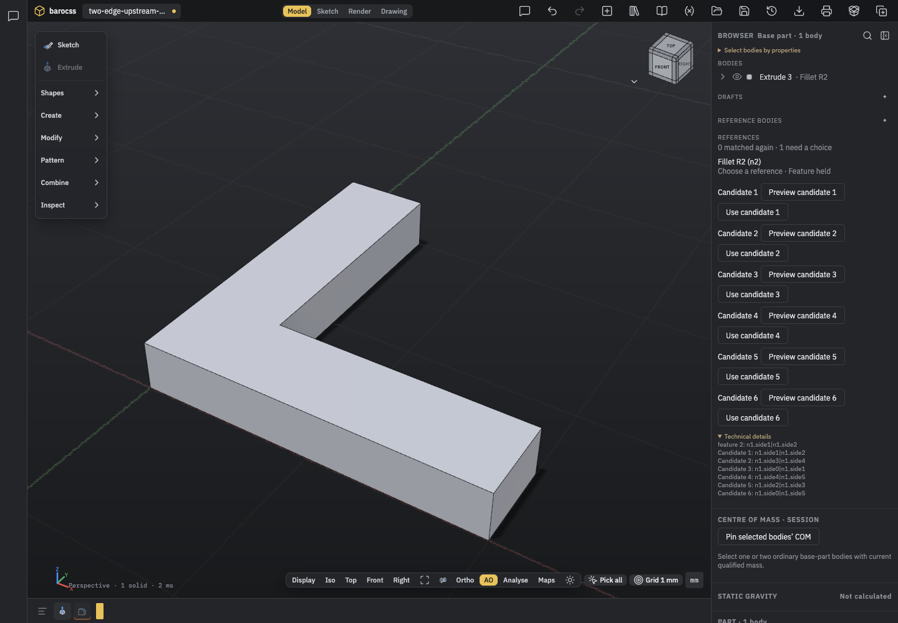

# #20: Existing two-edge Fillet References recovery

Test-only qualification on 01a41b891. Product gap hypothesis withdrawn; no product changes. Broader #20 remains OPEN.

## Question and result
History's direct Replace edge admission is single-edge, but that does not imply a two-edge feature cannot recover. References problems expose all matches within twice the nearest candidate distance, not just candidatesFor's default four suggestions. The desired inner corner was actual Candidate5 of6 and the existing Use candidate action recovered the two-edge constant Fillet.

## Reproducible geometry
Original polygon: [0,0],[20,0],[20,20],[15,20],[15,15],[5,15],[5,20],[0,20], H3. R2 finish on vertical edges at [20,20] and [20,0]. Changed L: [0,0],[20,0],[20,5],[5,5],[5,20],[0,20]. Original native captured signatures are retained in the changed file. Only the first reference is ambiguous; the [20,0] line retains the exact native midpoint [20,0,1.5], length3 and Z direction.

Native preflight verifies original and explicit target before browser conclusions. The desired new target is the concave [5,5] vertical edge, not an inferred continuation of the original edge. After existing candidate confirmation, the other edge and its signature, source nodes, radius, output and IDs remain unchanged.

## Verification
- Actual Chrome file Open, six candidate rows, Candidate5 selection, held recovery, Undo/Redo, Save/fresh Open PASS.
- Strict BRep and target volume525 mm³ PASS. Volume alone is insufficient because convex removal and concave addition cancel. Two R2 cylinders at [18,2] and [7,7], tangent points [18,0]/[20,2] and [7,5]/[5,7] at Z0/3 independently verify both locations.
- Original volume1050−6(4−π), two convex cylinders and retained line signature verified.
- Existing single-edge manual replacement positive control, native geometry, Undo/Redo and Save/fresh Open PASS.
- Node syntax, scoped ESLint and diff check PASS. Source changes=[], errors=[], all contexts/browser/server closed. Evidence screenshot visually reviewed.

Initial geometry comes from a supported synthetic file Open, not viewport creation or a live upstream sketch edit. No general two-edge direct History replacement, automatic matching, other geometries, varying/G2 or Chamfer expansion is claimed. No product types/build rerun is needed for this JavaScript-only test addition; exact publication CI is checked separately.

`TWO_EDGE_CONCAVE_REFERENCE_SOURCE_FROZEN=1 node apps/cad-studio/test/two-edge-concave-reference-browser.mjs OUTPUT --baseline`

