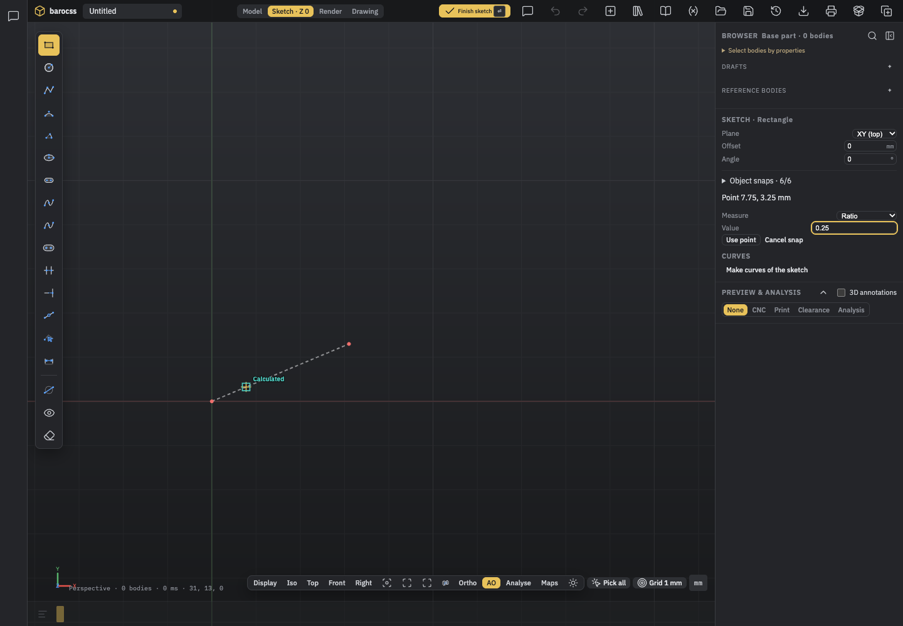
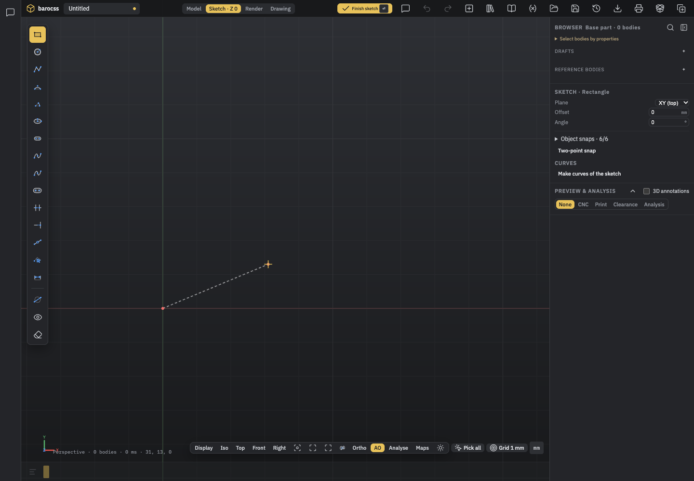

# #229 source-history acceptance attempt — 2026-11-17

Base `62a98187f`. **NOT_QUALIFIED for source mutation; no product defect established and no product changes.** Both raw FAIL attempts are preserved rather than converted into acceptance PASS.

## What happened

The public UI created an XY construction line (0,0)→(31,13), switched to Rectangle, selected both endpoints and displayed ratio 0.25 → (7.75,3.25) mm. The original plan expected public draft Undo to remove this source, Redo to restore only the source, then explicit reselection to create and save a rectangle.

- Actual01: the Undo request removed the calculation form and Calculated marker. The source line remained at identical projected points, and waiting for construction DOM count 0 timed out.
- Actual02: the test attempted a second public Undo, with the same strict count-0 expectation. It again timed out. No further actual runs were attempted.
- In **both initial pending snapshots**, Undo and Redo toolbar buttons were already disabled. The shared harness therefore sent its ordinary `Meta+z` fallback, not a click on an enabled Undo control. Both buttons remained disabled afterward. This fixture had no available source-edit history; increasing Undo counts was an incorrect test assumption.
- The narrow observed result is calculation cancellation on the public Undo key, with unchanged accepted document and source line. Source mutation, Redo recovery, subsequent explicit reselection, coordinate oracle and Save/fresh Open were **not reached**. There was no rectangle handoff to measure.

The first incorrect explanation that Undo restored an active line is **not proven**. We observed public DOM and source, not internal history stacks. `App.replayHistory` cancels two-point state before attempting history replay. `draftHistory.available/matches` and shape/done partition changes during `switchTool` explain why a drawing gesture need not supply an available edit at the later Rectangle stage; whether an internal clear branch executed in these runs was not instrumented or asserted.

## Existing evidence and next boundary

D793/D794 already cover computed placement and signed/offset-plane cases; D925 covers invalid File Open preservation and accepted File Open retirement. The prior Project Open attempt remains NOT_QUALIFIED because Versions is hidden during Sketch. This attempt does not replace those records or close #229.

A future bounded source-mutation fixture can reuse `test/arc-extension-source-edit-browser.mjs`: reopen an authored construction line with a crossing boundary, arm calculation, explicitly switch to Trim, trim the source, return to Rectangle, reject its old endpoint and explicitly acquire the new endpoint. That would test acquisition after a real public source mutation, **not editing while the calculation mode remains active**. No further fixture or actual run was implemented here. Parked construction is excluded by `canActivateDraftOutline`, so arbitrary coordinate editing or injected state must not substitute for a real supported UI path.

## Artifacts and checks

- `qualification.json`: compact original FAIL classifications, exact accepted docs, projected source points, initial/final disabled toolbar state, cleanup and frozen-source comparison.
- `attempt-driver.mjs`: final failed actual02 driver, moved out of `test/` so it is not presented as a passing runnable regression. Its relative imports and source pin refer to its original test location. It is archived evidence, not a standalone runnable test here.
- Raw runs `/tmp/cad-two-point-source-history01` and `02`, logs with matching names. Both process exit 1; errors/console errors/source changes zero; contexts, browser and server closed; heavy gate released.
- Before execution: Node 22 `node --check test/two-point-snap-source-history-browser.mjs` and scoped eslint PASS. Actual command: `TWO_POINT_HISTORY_FROZEN=1 node test/two-point-snap-source-history-browser.mjs <run-directory>` under the shared heavy gate. No product typecheck/build/native inspector repeated for a test-only failed qualification.
- Source writes were frozen throughout each actual run and coordinated with #239. No protected WIP/HOLD files changed.

The pending image was directly viewed: synthetic line and numerical input, no personal information. Images document the attempted boundary, not completed source-edit acceptance.
