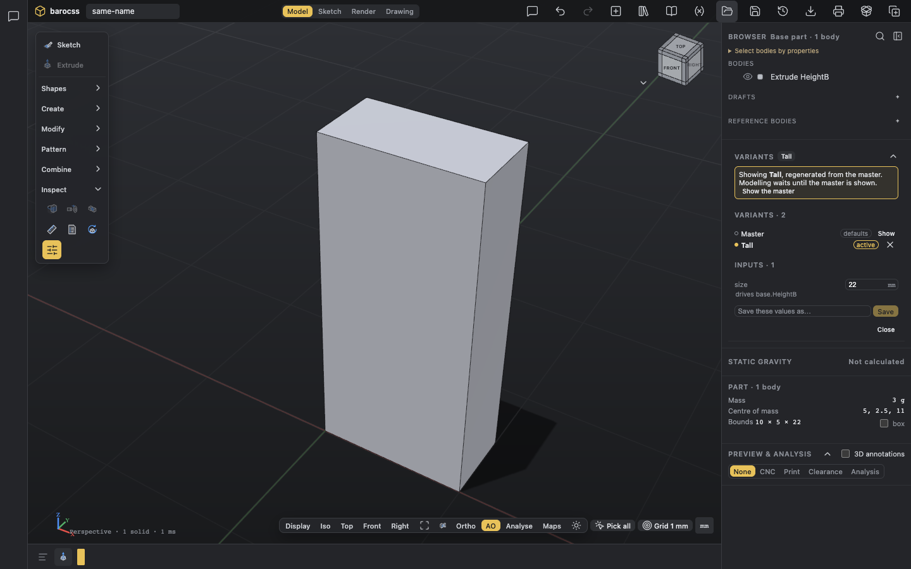

# Variants: invalid A draft to saved-active B

Issue #256, 2026-11-17. Test/evidence only; no Variants product modification. The existing D573 document-scoped reset and later invalid-input last-valid-preview implementation are retained.

One actual desktop acceptance run PASS: A Master `size=40` then invalid `101` retains A last-valid height 40. Public Open accepts independent B with the same filename/input name, a different HeightB binding, default 10 and saved active Tall22. The first and every observed B evaluation request before explicit Show Master carries HeightB22 (request/revision 7). B displays 22/Tall without A error or edited banner; its stored document is exact. Show Master yields 10 and changes only active selection as expected.

Four independent literal box checks pass: A valid40 and invalid101 both 2000 mm³/centroid(5,2.5,20); B Tall22 1100 mm³/(5,2.5,11); B Master10 500 mm³/(5,2.5,5), unchanged 1e-9 absolute tolerance. The passive Worker observer records requests without modifying them. No downloads, browser errors, source writes or leaked owned processes. Driver syntax PASS; final common Studio build 4.50s PASS.

OPEN remains: boolean/choice inputs, delayed replies, remaining document-entry combinations and A-draft→B-Open→STEP/3MF output remain NOT_RUN. Do not substitute this numeric combination for the full issue's acceptance. Existing source and retained D573/#77 evidence are not new runs.

Actual owned fixture; directly reviewed for personal/authentication information. Image shows the UI state; the independent quantities and first Worker record supply numeric/ownership evidence.
