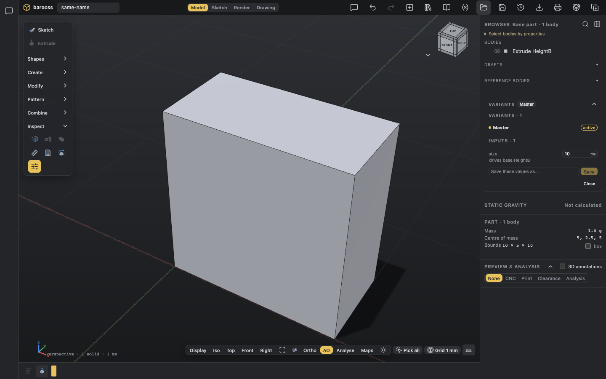

# #256 — Late variant response across accepted Open

Verification only, parent `1081cbb522ea`. No product changes or new variant policy.

## Actual acceptance

On synthetic 10 × 5 mm boxes, open A (HeightA default 20), enter an unsaved size 40, and hold its real successful evaluation reply. Then accept B through the public Open file chooser (HeightB default 10). The driver preserves every original response payload and releases callbacks on the held Worker in FIFO order, including subsequent messages; it does not reverse mesh deltas or fabricate a result.

Final run **PASS**: the held request is id 4 / revision 4 with HeightA 40. B's first and all recorded evaluation requests use HeightB 10 (id 6 / revision 6). Before release, B's authored document and input are already 10, while the retained last-good A20 body is explicitly stale (`fresh: false`, volume 1000 mm³). This is not a current B result.

At each released callback and following event-loop tick, all six samples remain stale with that last-good body. None shows the A40 result as current. These are bounded delivery samples, not an assertion about every possible render. After readiness, B has native volume 500.00000000000006 mm³ and centroid approximately [5, 2.5, 5], checked against independent literal values with absolute tolerance 1e-9. B document, selection and dirty state match the state captured immediately after accepted Open. The panel shows Master and size 10 without the previous edited banner or errors.



Actual screenshot reviewed by implementer and root: own fixture only, no personal/account data. This copy is unaltered; no synthetic UI or geometry has been added.

## Reproduction and evidence

From `apps/cad-studio`, with Node 22, local PW_DIR and CHROME, whole-source freeze and shared heavy gate:

```sh
VARIANT_ACTIVE_BOUNDARY_FROZEN=1 node test/variant-active-document-boundary-browser.mjs /tmp/cad-variant-late-boundary-02 --late-only
```

- Final02: PASS, zero downloads/errors; context, browser and server closed; 513 frozen sources unchanged through cleanup.
- First01: PASS before the held-request parameter assertion and delivery samples were added. Retained separately, not used as proof of those stronger assertions.
- `--late-only` does not rerun the prior numeric-invalid to saved-active acceptance. The default scenario is retained unchanged.
- Driver syntax and Git whitespace checks PASS. Product type/build checks were not repeated because this change is test/evidence only.

## Remaining issue scope

No new product defect found. #256 remains open: boolean/choice and differing input-range cross-document combinations, template/project/version/recovery/in-place actual entry combinations, and exact A-draft→B-Open STEP/3MF consumption remain unexecuted by this run. D573 and subsequent saved-active/fresh-Open evidence remain historical evidence, not new executions. The existing same-document variant/export evidence does not substitute for those exact cross-document combinations. No WIP/HOLD, schema, kernel, UI policy or export behavior changes.
