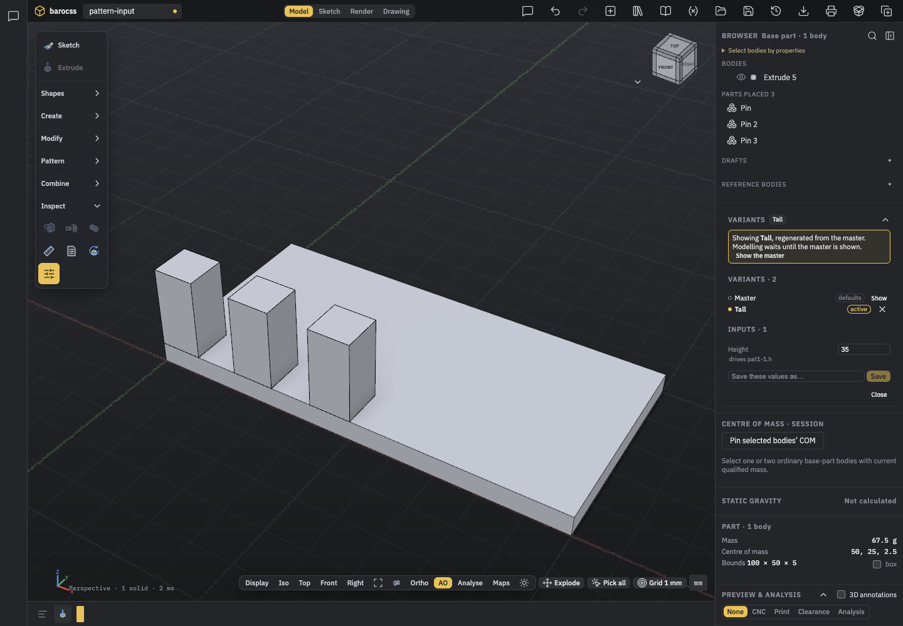
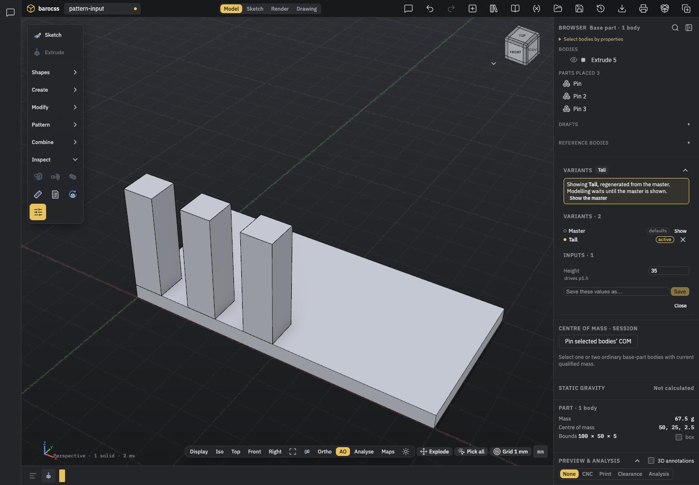

# Pattern-driven Variant targets — #704

## Contract and scope
Pattern occurrences are driven copies of the seed. `variantOf` applies bindings and then solves/regenerates patterns. A direct write to a copy used to be accepted and discarded. The bounded fix rejects parameter, suppression and component **write targets** that are occurrences with `INPUT_TARGET`, naming the seed. It does not add independent occurrence editing, redirect input automatically, or block component `like` read sources and mates.

## Actual baseline
At main `0da73d7a3`, public `set_inputs` admitted Height targeting `pat1-1.h`. Actual Studio Open and Show Tall displayed Height 35 and `drives pat1-1.h`, but every pin retained h20 and volume 2000 mm³ (floating-point tolerance 1e-8). The expected refusal assertion failed after the screenshot and geometry inspection. Original document unchanged.

## Fixed consumer and recovery
The same public request returns `[INPUT_TARGET] ... bind its seed p1 ...`, with exact original document identity and no mutation. Explicitly authoring the same input on p1 is accepted. Actual Studio Show Tall then shows all three pins at h35 and 3500 mm³ each. Actual Save/fresh Open, Show master, Undo and Redo passed. The source master still contains the original parts.

Existing files containing invalid occurrence bindings still roundtrip without deleting or redirecting their data. `variantOf` diagnoses these bindings even for defaults; public `set_inputs` can explicitly repair them to the seed. Existing active invalid variants are not silently regenerated as successful configurations. Native-file retention and recovery are covered by focused tests, not by the browser screenshot.

## Verification
- Focused + existing O11/instance-pattern/suppression regression: 41/41 PASS.
- Actual Chrome fixed driver: PASS; baseline expected FAIL with real mismatch.
- Both frozen receipts: changes=[]; contexts/browser/server cleanup confirmed.
- Product Model and Studio type checks and owned-file ESLint recorded at integration.
- Independent source review: no blocking findings.
- Disk reserve: 14 GiB before and after actual Chrome. No cache/source/evidence deletion.

Only this bounded behavior is qualified; no whole-CAD acceptance or new pattern editing capability is claimed. Existing WIP/HOLD and doc-sync pause remain.
