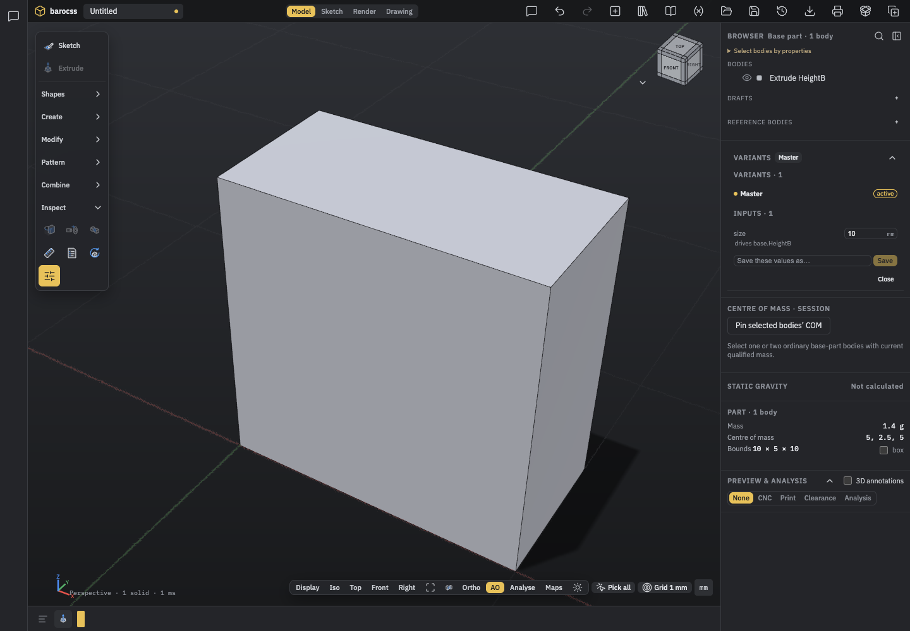
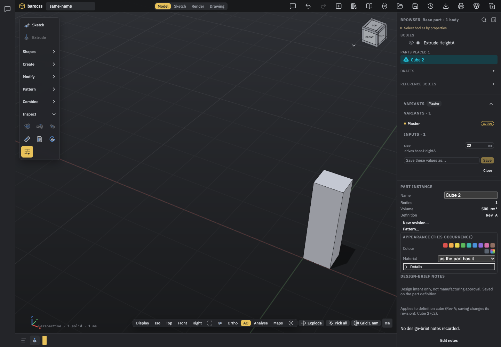

# #256: template and Edit in place variant boundaries

Evidence-only browser checks against `1d857f2fcb288461cb905e682200edfc76418231`. No product/main change. All documents and screenshots are synthetic.

## Verified
- Public **Save as a template** creates B (HeightB=10); A then shows unsaved working40. Public **New from B template** resets to B10 with no A draft/alert. First and every observed B evaluation request carry only HeightB=10 (one request).
- Single top-level Cube 2: A first rejects 101 while still showing Master. Normal **Edit part** enters B10 without the rejected A draft/alert. First and every observed child request carry only HeightB=10 (one request). Unchanged Master **Finish** returns exact original assembly A20.
- A working40 blocks Edit part. After Show the master, normal entry succeeds. Child working40 blocks Finish; supported **Cancel** returns exact original A20 without the working draft/alert.
- Independent Python literal-box oracle, no product imports: B volume 500 and centroid [5,2.5,5]; A working40 volume 1200 and centroid [3,2.5,20], absolute tolerance 1e-9 and zero relative tolerance. Native floating-point values retained in summary.
- Both final runs PASS; no downloads, browser errors, console errors or source changes. Context, browser and server closed.

## Evidence
Public New from B template: B10, Master, bounds and centroid visible.

After supported in-place Cancel: A Master20 and original Cube 2 instance restored. This image is a final state, not standalone proof of the preceding refusal; those assertions are in the run summary.

## Failure history and limits
Initial in-place run stopped at a fixture `volume === 2000` wait: native value was 2000.0000000000002. Finish refusal and Cancel were NOT_RUN in that attempt. Only the wait was changed to absolute tolerance 1e-9, then the entire flow passed. No product fix.

The raw in-place receipt inherited a template qualification string; the qualification in this sanitized summary is corrected from its executed phases and driver, not a claim of an additional run. Native oracles check local base/child bodies, not transformed world instance geometry. Child working40 uses a readiness/volume wait, not a separate centroid oracle. No feature edits, mates, broader assembly support, delayed Worker response, Save/fresh Open, export, browser-restart persistence or alternate routes are claimed here. Existing HOLD unchanged; #256 remains open. No downloads/exports were invoked.
