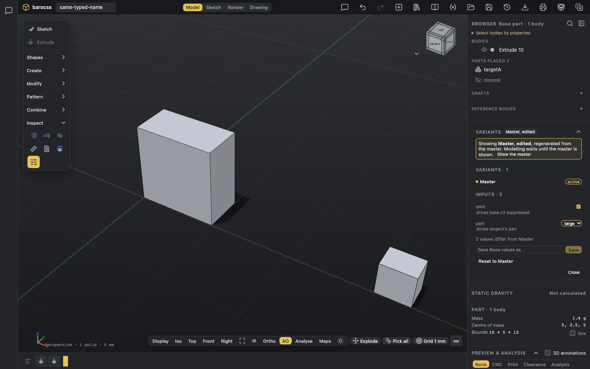
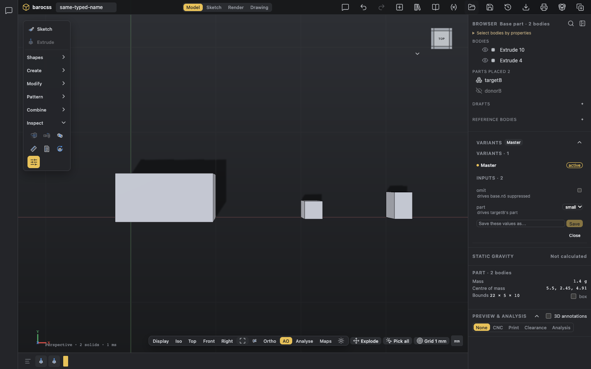

# #256 typed document boundary — 2026-11-17

Verification-only continuation on parent `5cf2631e5`. No Variants, Worker, schema or geometry product code changed. [Current issue](https://github.com/barocss/cad/issues/256), [retained saved-active numeric acceptance](https://github.com/barocss/cad/issues/256#issuecomment-6935089533), and [retained delayed-response acceptance](https://github.com/barocss/cad/issues/256#issuecomment-6935293965) remain distinct evidence. Their tests were not rerun here.

## One bounded typed transition

Independent A and B files use the same filename and input names, but different stable feature and instance targets. Boolean `omit` suppresses A n3 or B n5. Choice `part` changes targetA/targetB between its own small part and a hidden donor's larger part. Both default to false/small.

A's public Variants controls set true/large without Save or Update. Its authored master remains exact, the banner says Master edited, and the optional root body disappears. Public Open then accepts B. Before any new B input:

- First and all B root requests retain n5 unsuppressed; first target placed request uses BSmall, not ALarge or BLarge. The filter examines **all** placed requests at target position X30, not only expected source names. No A request appears after the Open boundary in the captured interval.
- B checkbox is false, select is small, Master is active with no edited banner or error. Authored B is exact and dirty is false.
- Actual root native volumes are500 and16 mm³, checked at unchanged absolute1e-9 tolerance. Original Worker callbacks run normally; afterward their product-decoded root bounds are read without changing payloads and match [0,0,0]..[10,5,10] and [20,0,0]..[22,2,4].
- Existing placed-mesh bounds show targetB at [30,0,0]..[32,3,4]. The independent rectangular volume expectation is24 mm³, **not a separately measured placed native volume**. No total540 native-measurement claim is made. A's edited target bounds instead end at X34.
- The actual screen displays two root boxes and the small target, with donorB hidden. This is screenshot/Outliner visibility evidence, not an exhaustive renderer-pass audit.
- Closing Variants and opening the existing Extrude History editor exposes enabled Distance input. Closing it without changes preserves B Doc and dirty=false, confirming that A's modelling lock did not follow B.

Original outgoing wire messages are observed only; node tables are resolved from the original added/ids data. No new product debug hooks, injected results, artificial delays, variant API bypass or external assets. Two small independent Python literal checks validate A/B root volumes and target bounds. This run does not add another held-response claim.





Both original actual PNGs directly inspected at pixel level. A shows true/large and edited status; B shows false/small, n5 and targetB ownership, the expected three visible boxes and hidden donor. Synthetic data only, no private/authentication information. Copies are unmodified.

## Results and limits

- `/tmp/cad-variant-typed-boundary-03`: **PASS**, exit0,515 frozen paths unchanged, zero changes/errors/downloads, context/browser/server cleanup complete. First B root request10, first target placed request11; three total outgoing requests after Open, one recorded current B root result.
- `node --check`, targeted ESLint and `git diff --check`: **PASS**. Product type/build and prior Model suites were not repeated for this test/evidence-only delta.
- Run01 **FAIL**: raw fixture output alias bExtra was canonicalized to stable b3, making exact readiness wait fail. Fixture changed to stable b3/b5; product untouched.
- Run02 **FAIL**: typed boundary checks passed, but the final editor assertion looked for Height. Failure HTML establishes the actual Distance label. Only that selector changed; final03 reran the full bounded case. Neither partial run is presented as overall PASS.

**Still NOT_RUN:** combined A-draft→B-Open→STEP/3MF output; remaining New/template/project/version/recovery/in-place entry-route combinations; saved B variant OPFS Save→Close→fresh Open. Previous source inspection of the shared replacement boundary is not actual acceptance of all routes. Issue256 stays OPEN; this resolves the boolean/choice branch only. Existing numeric/late evidence, all HOLDs and original WIP are preserved.

From `apps/cad-studio`, Node22 with PW_DIR/CHROME, shared heavy gate and full source freeze:

```sh
VARIANT_TYPED_BOUNDARY_FROZEN=1 node test/variant-typed-document-boundary-browser.mjs /tmp/cad-variant-typed-boundary-new
```

Receipt/driver/PNG SHA256 and first-request evidence are in [qualification.json](qualification.json). Local original FAIL and final PASS receipts remain intact.
