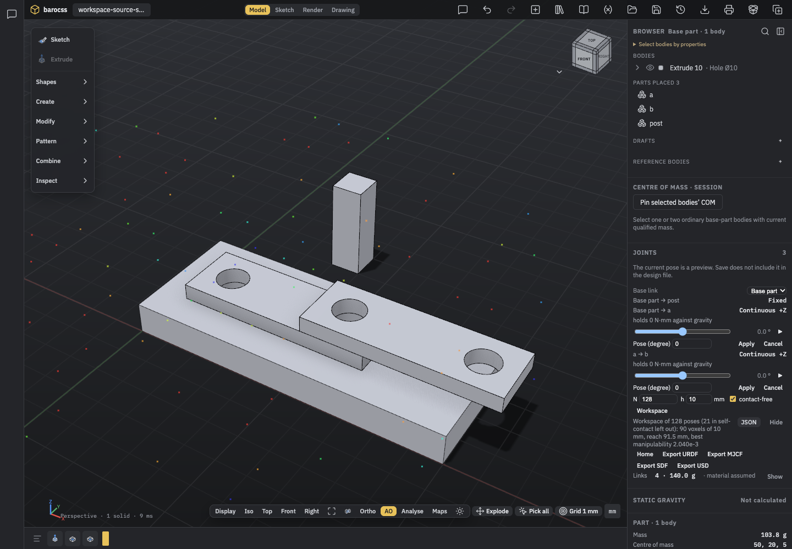

# #69 actual positive-exclusion Workspace accounting

Test/evidence only. Actual Chrome run pinned to `8250151272bcdd0b9db6a23b7bc919c3aa286dcb` with the accompanying test-only driver edit. **Not a browser run at the later publication SHA.** Upstream `6315e9cce` changes direct Join feedback and its tests/evidence; the Workspace driver/helper, robot and assembly paths, and CCD-post fixture are unchanged. No repeat browser run was needed for those unrelated changes.

## Actual result

Existing synthetic `packages/barocss-cad/conformance/rm/ccd-post/case.json` input.document, with the two existing solved placements a=[10,10,10], b=[50,10,15]. Grounded post is unchanged. Joints Workspace only, N128/h10; no Motion play, path sweep, physics simulation or geometry expansion.

| Contact-free | Requested/sampled | Excluded | Sum of voxel counts | Occupied voxels |
| --- | ---: | ---: | ---: | ---: |
| Off | 128 | 0 | 128 | 105 |
| On | 128 | 21 | 107 | 90 |

**PASS:** Actual UI displays `Workspace of 128 poses (21 in self-contact left out): 90 voxels of 10 mm`. Three real browser downloads completed without failure, not Blob interception. Python independently reopened the saved files after screenshots and checked integer accounting. Filtered repeated download has identical SHA-256. Literal counts were observed in this run, not guessed from the earlier helper test.

**PASS:** Exact accepted document, instance placements, displayed history and evaluated body key/volume/centroid preserved. Hide clears the map. 594 frozen inputs unchanged through cleanup; browser/page errors and watched changes empty; context/browser/server closed. Before and after mappings free disk exceeded 25 GiB. Syntax, scoped ESLint and diff checks pass.

## Corrected evidence custody

The earlier sample driver saved a download and `flow.snapshot` to the same label.json. Its immediate in-memory download assertions ran, but a later snapshot overwrote the retained file. The earlier public `valid100-workspace.json` and `valid200-workspace.json` therefore contain Studio state, not export payload. That immutable evidence is not relabeled here.

The driver now stores every actual export as `*-download.json`; screenshot/state labels remain separate. This run explicitly reopens the actual files after snapshots. Both supplied `contact-*-download.json` files contain only the Workspace export schema, not source snapshots. `independent-file-accounting.json` records the separate Python read and all three download hashes.

## Actual screenshots

These are actual unmodified Studio screenshots of the synthetic CCD-post fixture, not generated images or real customer geometry.




## Reproduction and limits

In an isolated checkout with existing Chrome/Playwright, serial heavy gate, frozen writers and at least 2 GiB reserve:

```sh
cd apps/cad-studio
WORKSPACE_SAMPLES_HEAD="$(git rev-parse HEAD)" WORKSPACE_SAMPLES_FROZEN=1 \
  node test/robot-workspace-samples-browser.mjs "$OUTPUT" --contact-only
```

Set existing `PW_DIR` and `CHROME` as for the other actual-Studio drivers. This run executes only two maps and three downloads. The previous invalid-input matrix was not rerun. General collision accuracy, independent physical classification of the 21 poses, max-N performance, assistive technology, forced-CPU matrix, hidden Undo stack, native Save/Open and dynamics are NOT_RUN. This qualifies count reporting and saved-file custody, not broad robot/physics readiness. Existing HOLDs are unchanged. Root performs issue closure adjudication separately.
