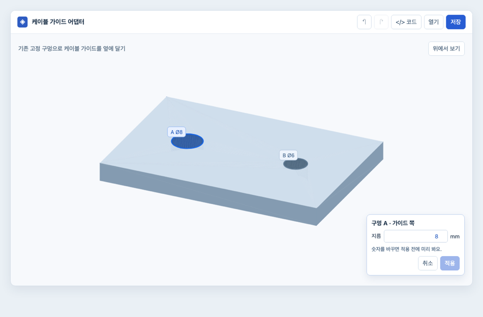

# Casual CAD

A small, separate entry point for the first [#749](https://github.com/barocss/cad/issues/749) workflow: fit a cable-guide adapter without changing the equipment's existing hole.

```sh
pnpm dev:casual
pnpm build:casual
pnpm --filter @barocss/casual-cad-app type-check
pnpm --filter @barocss/casual-cad-app test
```

The work area opens on a 60 × 40 × 5 mm plate with two independent through holes. Click a native upper rim or oblique bore wall (keyboard users can focus its label), type a diameter, and check the preview before applying. Save downloads only the applied document as a native `.bcad`. A new session can reopen that file. For expert edits, open the downloaded file in CAD Studio.

**Optional code:** open the left panel (below canvas on a narrow screen). `holeA.diameter = 8` is a bounded numeric assignment, not JavaScript. It uses the same preview and apply path. The parser loads when the panel opens.

**Deliberate limits.** This increment edits two independent straight Z through holes in one rectangular extrusion. It refuses unsupported models without rewriting them and directs the user to open the original in Studio. It is not a general importer, template builder, arbitrary-code editor, or assembly workspace. Sensor enclosures, center-linked vise assemblies and more feature types remain follow-ups. App-local undo is not carried by the native file. Uses two viewport presets, not a full camera controller.

## Verification

The core tests measure native rim samples independently of the editable fields, check target isolation and stale edit rejection, and round-trip native serialization with shared Centre Y. The browser script uses a fresh context against the actual production build and checks visible wall and rim picks, prepare/cancel/apply/Undo/Redo, invalid sizing, optional code, and save plus fresh reopen. It requires Playwright and a local compatible Chromium:

```sh
cd apps/casual-cad
PLAYWRIGHT_MODULE=/path/to/playwright CHROME_PATH=/path/to/chromium node test/browser.mjs
```

Build Studio from the same checkout with `pnpm build` and set `CHECK_STUDIO=1` to also exercise the real Studio feature editor and round trip.

The first model/preview loads no Studio shell, worker, WASM, or code parser in the tested build. The shared evaluator and native format reader are still part of the startup bundle; the separate entry point is not a claim that the kernel payload has been optimized.


