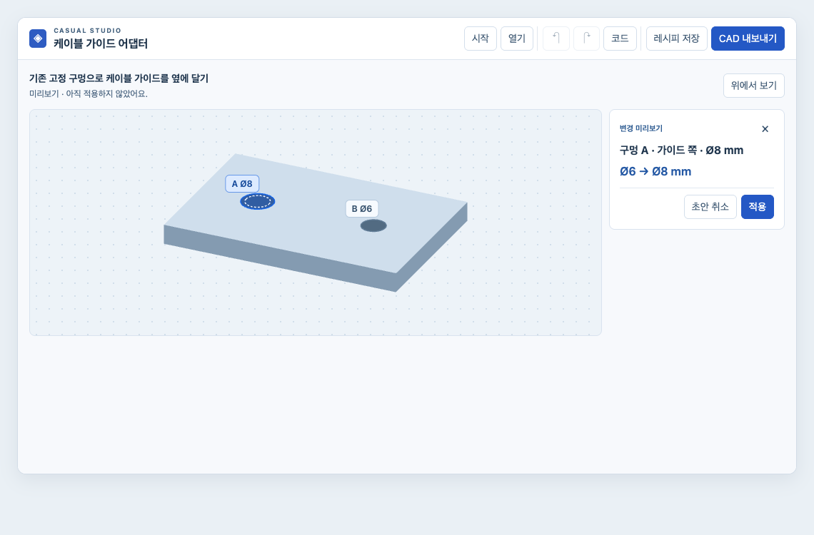
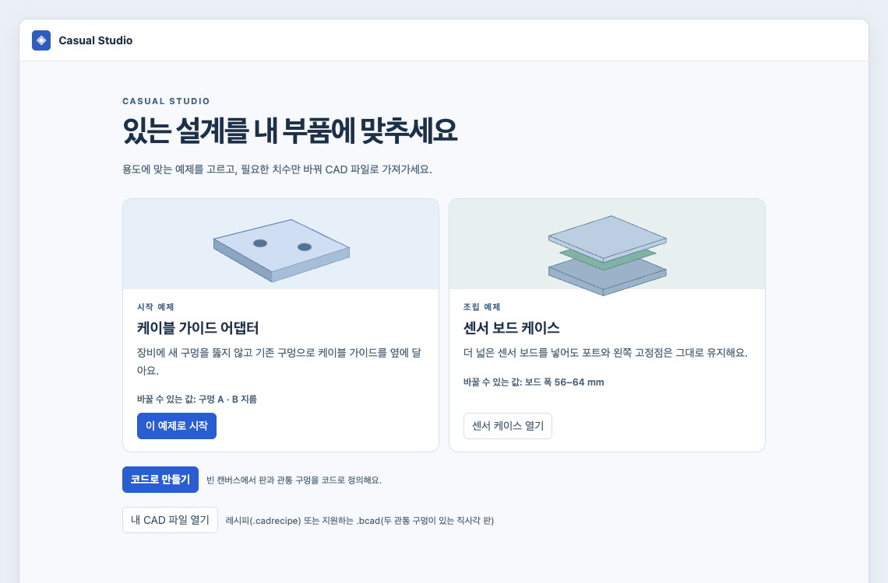
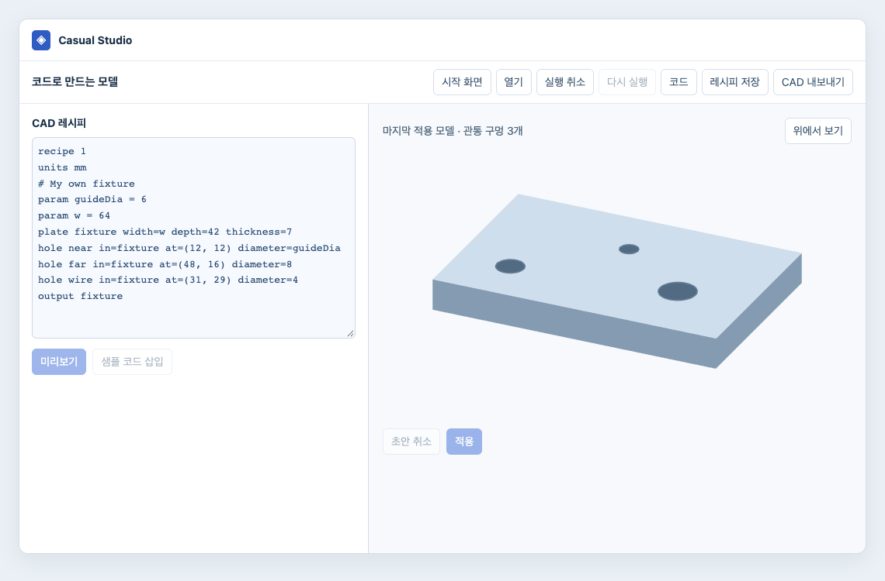

# Casual Studio

A small, separate entry point for the first [#749](https://github.com/barocss/cad/issues/749) workflow: fit a cable-guide adapter without changing the equipment's existing hole.

```sh
pnpm dev:casual
pnpm build:casual
pnpm --filter @barocss/casual-studio-app type-check
pnpm --filter @barocss/casual-studio-app test
```

From the start screen, choose the cable-guide example or open a supported native file. The example opens the same recipe editor as the blank-code path, with the code panel closed. Pick hole A or B on the 60 × 40 × 5 mm plate, enter a diameter and preview before applying. Edits can be exported to `.bcad` or saved as a recipe. Resetting a diameter to its example default is also a preview, not an immediate change.

**Existing native file:** the bounded native import editor keeps the original feature graph and opens the optional one-line diameter editor on request. It does not generate a recipe from the file.

**Create from code:** choose **코드로 만들기** for a blank document. Enter a version 1 recipe, preview, then apply. A recipe defines one rectangle/extrusion and up to eight vertical through-holes. Open and save the executable text as `.cadrecipe`, or export the applied native features as `.bcad`. Radius derived from a recipe diameter is exported as its current value; the source relation remains in the recipe. See the [working syntax example](PRODUCT.md#코드는-모델-전체를-정의할-수-있어야-한다).

**Deliberate limits.** Existing `.bcad` import still accepts the bounded two-hole shape, not every recipe export; keep the corresponding recipe to reopen the source in Casual. Unsupported native files are not rewritten and may be opened in CAD Studio. Recipe hole diameter declarations are editable from the canvas; fixed literals are not. Sensor enclosures and center-linked vise assemblies remain future work. Arbitrary code execution and general import remain out of scope. App-local undo is not carried by the native file. Uses two viewport presets, not a full camera controller.

See the [product plan](PRODUCT.md) and the [roadmap](ROADMAP.md) for the next use cases and their acceptance checks.

## Verification

The core tests measure native rim samples independently of the editable fields, check target isolation and stale edit rejection, and round-trip native serialization with shared Centre Y. The browser script uses a fresh context against the actual production build and checks visible wall and rim picks, prepare/cancel/apply/Undo/Redo, invalid sizing, optional code, and save plus fresh reopen. It also checks the starter on desktop and a narrow viewport, pending edit protection, a genuinely blank recipe, invalid input and stale preview rejection, source save/reopen, and a separate CAD Studio edit of the exported three-hole plate. It requires Playwright and a local compatible Chromium:

```sh
cd apps/casual-studio
PLAYWRIGHT_MODULE=/path/to/playwright CHROME_PATH=/path/to/chromium node test/browser.mjs
```

Build Studio from the same checkout with `pnpm build` and set `CHECK_STUDIO=1` to also exercise the real Studio feature editor and round trip.

The landing page and first native import preview load no Studio shell, worker, WASM or recipe compiler in the tested build. The example and blank-code entry load the recipe compiler on demand. The shared evaluator and native format reader are still part of startup.

[Desktop selection and preview](casual-context-desktop.png) · [390 px touch selection and preview](casual-context-mobile.png)






