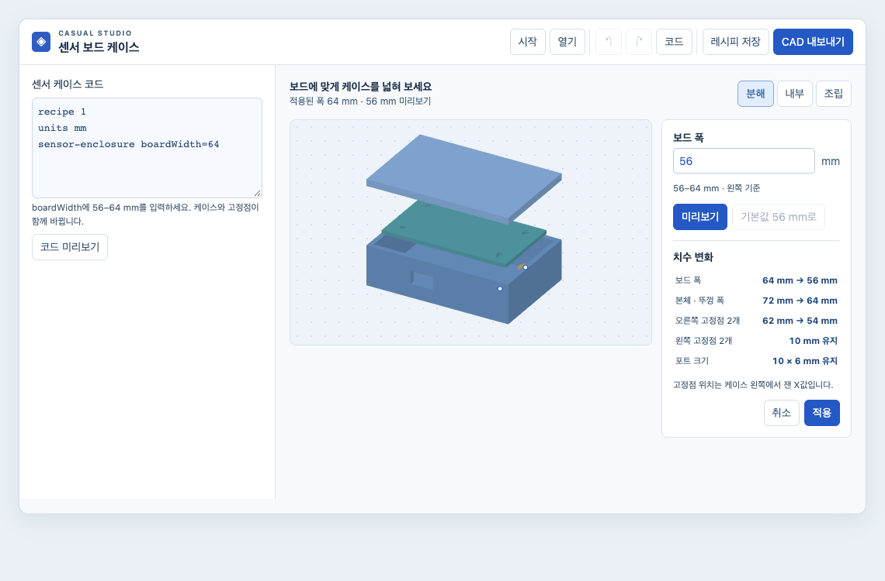

# 센서 케이스 · 치수 관계 검증

Casual Studio 시작 화면의 **센서 케이스 열기**에서 사용할 수 있다. 보드 폭을 바꾸고 **미리보기**를 누르면 기존 값, 새 값, 유지되는 값을 나란히 볼 수 있다. 분해·내부·조립은 보는 방식만 바꾸며 실제 배치나 파일을 바꾸지 않는다. 변경 목록에 포커스를 두면 관련 부품 또는 고정점이 강조된다. **적용** 후 레시피를 저장하면 Casual에서 다시 편집할 수 있고, **CAD 내보내기**로 만든 BCAD는 CAD Studio에서 열 수 있다.

[Casual Studio 실제 데스크탑 미리보기](04-casual-preview.png)

적용된 폭이 기본값과 다르면 **기본값 56 mm로**가 나타난다. 이 버튼은 현재 모델을 바로 바꾸지 않고 복원 결과를 먼저 보여준다. 치수나 코드 초안이 있으면 초안을 덮어쓰지 않는다. 64 mm에서 복원하면 본체·뚜껑 폭은 72→64 mm, 오른쪽 고정점은 62→54 mm이며 왼쪽 고정점과 포트는 그대로다. 취소는 이력을 만들지 않고 적용은 Undo 한 번으로 복귀한다.



초기 형상만 확인하려면 CAD Studio에서 [sensor-enclosure.bcad](sensor-enclosure.bcad)를 **Open**으로 열고 **Inspect → Variants → Show 64 mm board**를 눌러 비교할 수 있다. 기본값으로 돌아가려면 **Show the master**를 누른다.

| 실제 형상에서 잰 값 | 기본값 | 64 mm 보드 |
| --- | --- | --- |
| 보드 폭 | 56 mm | 64 mm |
| 본체·뚜껑 폭 | 64 mm | 72 mm |
| 오른쪽 고정점 2개, 왼쪽 기준 X | 54 mm | 62 mm |
| 왼쪽 고정점 2개, 왼쪽 기준 X | 10 mm | 10 mm |
| 앞쪽 관통 포트 | 10 × 6 mm | 10 × 6 mm |

본체, 뚜껑, PCB, 지지대 네 개는 일곱 개의 닫힌 B-rep이다. 기존 CAD Studio의 Variants 입력 `boardWidth`(56–64 mm) 하나가 본체 외폭, 내부 벽, PCB 우측 경계와 두 우측 고정점을 구동한다. 네 보어도 각 지지대 축에 맞는다. 저장 후 재열기에서 입력과 관계가 유지된다. Casual에서 64 mm를 적용해 내보낸 파일은 64 mm가 기준값이며, CAD Studio의 **Show 56 mm board**로 다시 56 mm 형상을 계산할 수 있다. 지지대는 형상 확인용 별도 솔리드이며 나사 체결, 뚜껑 고정 방식, 제작 공차는 검증 범위가 아니다.

[56 mm 데스크탑 검증](01-56-mm.png) · [64 mm 데스크탑 검증](02-64-mm.png) · [뚜껑을 숨긴 내부](03-interior.png)

## 재현

저장소 루트에서:

```sh
work=$(mktemp -d)
pnpm --filter @barocss/casual-studio-app test
pnpm exec esbuild apps/casual-studio/examples/sensor-enclosure/build.ts --bundle --platform=node --format=esm --outfile="$work/build.mjs"
node "$work/build.mjs" "$work/sensor-enclosure.bcad"
pnpm build
PLAYWRIGHT_MODULE=/path/to/playwright CHROME_PATH=/path/to/chromium node apps/casual-studio/examples/sensor-enclosure/capture.mjs "$work"
```

형상 테스트는 56, 60.5, 64 mm에서 솔리드의 경계, PCB 보어, 고정점과 관통 포트를 확인한다. 브라우저 재현은 데스크탑 화면의 파일 열기와 56 ↔ 64 mm 전환을 확인한다.

Casual의 복원 동작은 앱을 빌드한 뒤 같은 폴더에서 `DESKTOP_ONLY=1 PLAYWRIGHT_MODULE=/path/to/playwright CHROME_PATH=/path/to/chromium node test/browser.mjs`로 재현한다. 이 테스트는 취소·적용·실행 취소/다시 실행과 저장한 레시피의 재열기, 적용한 56 mm BCAD의 치수 관계를 확인한다. 실제 첫 사용자 수행 시간은 측정하지 않았다.
